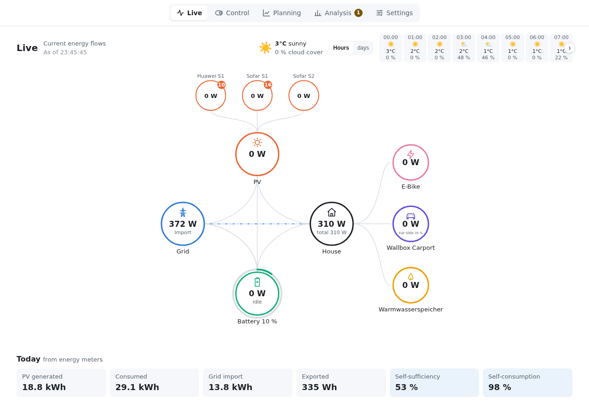
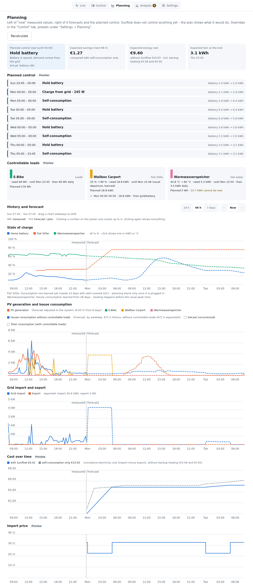
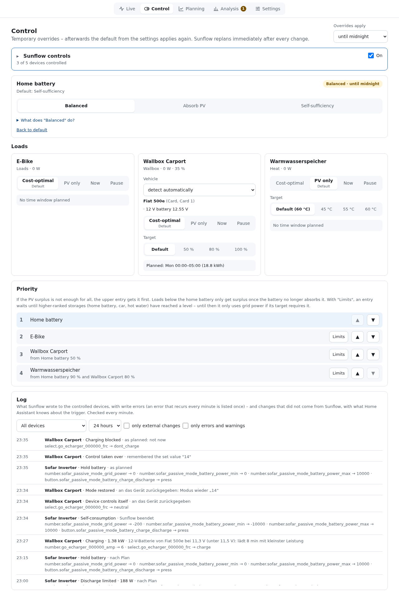
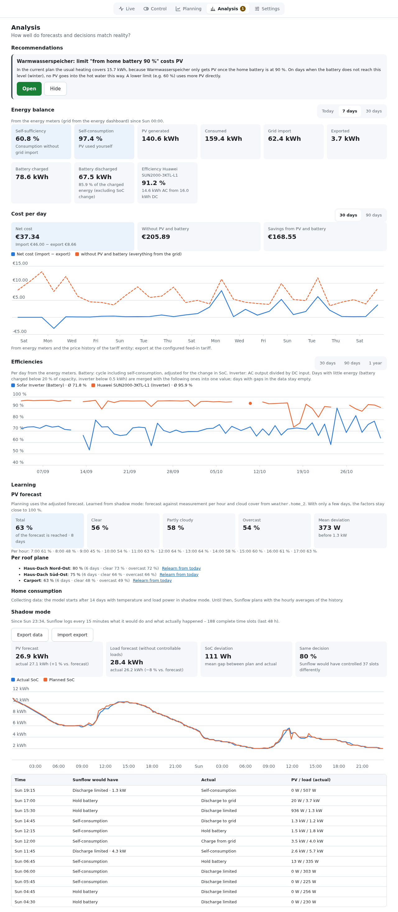

# Sunflow

Predictive energy management for Home Assistant. Sunflow plans the home battery,
EV charging, hot water and other loads around the PV forecast and the electricity
price, and can carry out the plan itself – using the integrations you already have.

*Vorausschauendes Energiemanagement für Home Assistant: Sunflow plant Speicher,
Wallbox, Warmwasser und weitere Verbraucher nach PV-Prognose und Strompreis und setzt
den Plan auf Wunsch selbst um.* → [Dokumentation auf Deutsch](docs/README.md)

> [!WARNING]
> **Private project, use at your own risk.** Sunflow is developed privately in spare time
> and is not affiliated with Home Assistant or the device manufacturers. It writes to
> inverters, batteries and wallboxes; errors in Sunflow or in its settings can damage
> devices. Warranty and liability are excluded as set out in the [license](LICENSE).
>
> **Privat entwickelt, Nutzung auf eigenes Risiko.** Sunflow wird privat in der Freizeit
> entwickelt und steht in keiner Verbindung zu Home Assistant oder den Geräteherstellern.
> Es schreibt an Wechselrichter, Speicher und Wallboxen; Fehler in Sunflow oder in den
> Einstellungen können Geräte beschädigen. Gewährleistung und Haftung sind nach der
> [Lizenz](LICENSE) ausgeschlossen.



## Features

- **Plans 96 hours ahead** in quarter hours with a mixed-integer optimizer: prices,
  feed-in tariff, PV and load forecast, battery losses, wear and calendar ageing.
- **Four battery strategies**: balanced (lowest cost), absorb as much PV as possible,
  as self-sufficient as possible, or battery use (a buffer for a day above the forecast);
  backup reserve, charge limit and periodic full charges.
- **Several batteries** planned together, e.g. a hybrid inverter and a plug-in storage.
- **EV charging**: vehicle detection by RFID card or selection, targets and deadlines,
  PV surplus charging with 1 ↔ 3 phase switching (go-e), learned arrival and
  consumption, 12 V battery protection, "worth plugging in" hint, several RFID cards per
  vehicle with their own targets.
- **Statistics of the loads** like evcc's (charged energy, solar share, price, cost per month,
  load and vehicle), with a one-time import of evcc's sessions.
- **Hot water and own loads**: heating rods, switches, power levels and target
  currents; learned hot water demand; one-off loads such as a washing machine at the
  cheapest time.
- **Learns** the PV forecast per roof plane, cloud cover and sun position (shading), spots a
  soiled plane (snow, leaves) against the others, house consumption, car and hot water usage,
  and estimates a car's state of charge between its reports.
- **Dynamic tariffs**: Tibber, Nord Pool, EPEX Spot (aWATTar, smartENERGY,
  Energy-Charts …), ENTSO-E, Octopus; price estimate beyond the published prices.
- **Shadow mode first**: Sunflow records what it would do before you hand over
  control; afterwards it controls inverters, wallboxes and loads with safeguards
  (watchdog, fallback to self-consumption, control log).
- **Home Assistant integration**: learned PV forecast for the Energy dashboard,
  entities, actions and events for your automations.
- **Read-only MCP server** so AI assistants such as Claude Code can explain plan,
  history and errors.

| Planning | Control | Analysis |
|---|---|---|
|  |  |  |

## Documentation

| | Deutsch | English |
|---|---|---|
| Overview | [Dokumentation](docs/README.md) | [Documentation](docs/en/README.md) |
| Installation and setup | [Installation und Einrichtung](docs/installation.md) | [Installation and setup](docs/en/installation.md) |
| User interface | [Bedienung](docs/bedienung.md) | [User interface](docs/en/user-interface.md) |
| Handing over control | [Steuerung übernehmen](docs/steuerung.md) | [Handing over control](docs/en/control.md) |
| Settings | [Einstellungen](docs/einstellungen.md) | [Settings](docs/en/settings.md) |
| How Sunflow plans | [So plant Sunflow](docs/planung.md) | [How Sunflow plans](docs/en/planning.md) |
| Supported devices | [Unterstützte Geräte](docs/geraete.md) | [Supported devices](docs/en/devices.md) |
| Electricity prices | [Strompreise](docs/strompreise.md) | [Electricity prices](docs/en/prices.md) |
| Optimizers | [Optimierer](docs/optimierer.md) | [Optimizers](docs/en/optimizers.md) |
| Home Assistant integration | [Sunflow-Integration](docs/integration.md) | [Sunflow integration](docs/en/integration.md) |
| MCP server | [MCP-Server](docs/mcp.md) | [MCP server](docs/en/mcp.md) |
| Troubleshooting | [Fehlersuche](docs/fehlersuche.md) | [Troubleshooting](docs/en/troubleshooting.md) |

The user interface is available in German and English and follows the language of Home Assistant.

## Supported devices (overview)

Inverters and batteries: Sofar HYD-KTL, SolaX Gen4/5, Huawei SUN2000 (with and
without LUNA2000), SolarEdge StorEdge, Fronius GEN24 Plus, GoodWe ET/EH/BT, Kostal
Plenticore, Victron ESS (Modbus TCP). Plug-in and home storage: Indevolt, Homevolt,
Marstek Venus, Zendure. Meters: Tibber Pulse. Wallboxes: evcc
loadpoints, go-e Charger (API v1 and v2). Optimizers: Huawei, Tigo. Plus generic
switches, power levels and target currents. Test status per device in
[Supported devices](docs/en/devices.md).

## Installation as Home Assistant App

1. Settings → Apps → App store → ⋮ → Repositories → add `https://github.com/Zwer2k/sunflow`
2. Install "Sunflow"
3. Start it and open the Sunflow panel; set up devices in the wizard

The Home Assistant integration (optional: Energy dashboard forecast, entities, actions)
is installed with HACS: search for "Sunflow" in HACS → download → restart Home Assistant. It
needs the App: on its own it does nothing.

[](https://my.home-assistant.io/redirect/hacs_repository/?owner=Zwer2k&repository=sunflow&category=integration)

Step-by-step guide: [Installation and setup](docs/en/installation.md).

The repository offers two Apps. Run only one of them; the other stands aside
(no control, no announcement to the integration) while both are started.

| App | Folder | Updates | Image |
|---|---|---|---|
| Sunflow | `sunflow_app/` | GitHub releases | prebuilt on ghcr.io by `.github/workflows/release.yml` |
| Sunflow Edge | `sunflow_app_edge/` | every version bump on `main` | built on the device from `main` |

Moving between them: "Export data" in the old App, "Import export" with
"With configuration" in the new one (Analysis → Shadow mode). Control stays off
after the move until it is switched on again.

## Releasing

Every change on `main` raises the version in `sunflow_app_edge/config.yaml`,
`backend/pyproject.toml` and `backend/sunflow/__init__.py` and gets a section in
`sunflow_app/CHANGELOG.md`; Sunflow Edge offers it as an update.

To release the current state of `main` as the stable App, tag it with that version:

```bash
git tag v0.74.0 && git push origin v0.74.0
```

The workflow checks that the tag matches the code version, builds the images for
amd64 and aarch64, then sets the version in `sunflow_app/config.yaml` (only now does
Home Assistant offer the update) and creates the GitHub release with all changelog
sections since the previous release. The image packages on ghcr.io have to be public
once (package settings on GitHub), or Home Assistant cannot pull them.

## Repository layout

| Path | Content |
|---|---|
| `sunflow_app/` | Home Assistant App (config, Dockerfile) |
| `backend/` | Python backend: HA client, optimizer, forecasting, API |
| `frontend/` | Web UI: setup wizard, plan view (served by the backend / Ingress) |
| `custom_components/sunflow_ems/` | Thin integration (HACS): entities, actions, watchdog |
| `profiles/` | Manufacturer profiles mapping roles/actions to HA entities |
| `schema/` | JSON schemas for profiles and configuration |
| `tests/` | Tests |
| `docs/` | User documentation in German (`docs/`) and English (`docs/en/`), screenshots in `docs/images/` |

The same repository is added both to the App store (`repository.yaml`) and to
HACS (`hacs.json`).

### Backend (`backend/sunflow/`)

| Package | Content |
|---|---|
| `api/` | HTTP API, one router per area (devices, setup, sources, plan, control, …); `app.py` builds the app |
| `config/` | Configuration model (`models.py`) and its storage with migrations (`store.py`) |
| `devices/` | Profiles, discovery, entity roles, writing to devices, device test, site view |
| `planning/` | Forecast sources, load and PV learning, vehicles, the optimizer and the plan |
| `control/` | Carrying out the plan on batteries and loadpoints |
| `shadow/` | Background loop and the recorded plan vs. measurement |
| `analysis/` | Energy balance, costs, efficiency, history, recommendations |
| `ha/` | Home Assistant websocket client |

### Frontend (`frontend/src/`)

| Folder | Content |
|---|---|
| `app.js` | Shell: navigation, setup and settings |
| `views/` | Live, plan, control, analysis |
| `settings/` | Settings areas |
| `components/` | Charts, energy flows, dialog, entity picker |
| `lib/` | API client, formatting, polling |

Profiles are grouped by kind of device (`profiles/inverters/`, `meters/`,
`loadpoints/`, `loads/`); a profile is identified by its `profile` field, not
its path.

## Development

The backend runs as a plain process during development and connects to a
Home Assistant instance with a long-lived access token:

```bash
cd backend
# In the HA devcontainer the HA venv is active and uv only accepts system interpreters
env -u VIRTUAL_ENV uv venv --python /home/vscode/.local/bin/python3.14 .venv
env -u VIRTUAL_ENV uv pip install --python .venv/bin/python -e ".[dev]"
.venv/bin/python -m sunflow
```

Settings are read from the environment or from `backend/.env` (git-ignored):

```
SUNFLOW_HA_TOKEN=<long-lived access token>
# optional
SUNFLOW_HA_URL=http://localhost:8123
SUNFLOW_PORT=8099
# refuse a wrong integration token like the App (to test the integration's reauth)
SUNFLOW_REQUIRE_TOKEN=1
```

Inside the App it uses the Supervisor proxy and `SUPERVISOR_TOKEN` instead.

## License

Copyright 2026 Jurij Retzlaff. Licensed under the [Apache License 2.0](LICENSE).
The bundled Lit library (`frontend/vendor/`) is © Google LLC under the BSD-3-Clause license.
