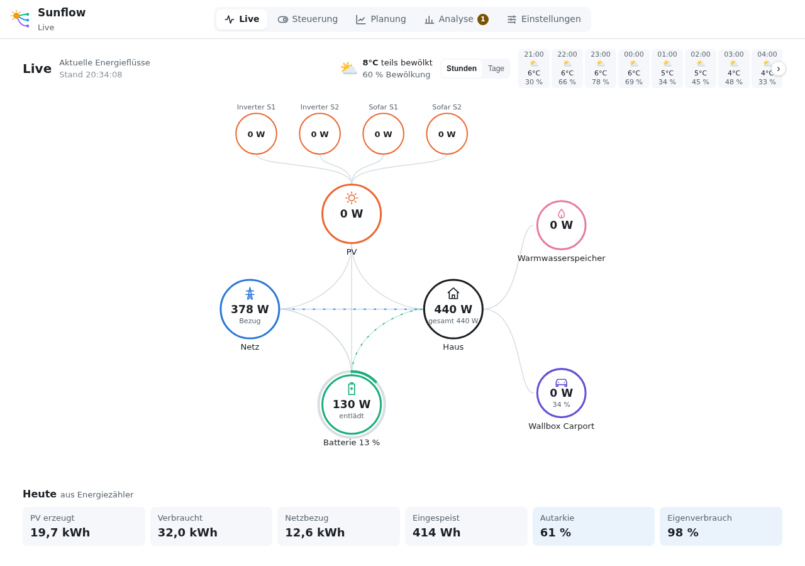

# Sunflow – Dokumentation

**Deutsch** · [English](en/README.md)

Sunflow plant Hausspeicher, Wallbox, Warmwasser und andere Verbraucher vorausschauend nach
PV-Prognose und Strompreis und setzt den Plan auf Wunsch selbst um. Es läuft als App in Home
Assistant und nutzt die Integrationen, die du dort schon hast. Eigene Gerätetreiber braucht es nicht.

## Erste Schritte

1. [Installation und Einrichtung](installation.md): App installieren, Integrationen wählen,
   Geräte übernehmen, Gerätetest, Bilanzprüfung, Tarif und Prognose.
2. [Bedienung](bedienung.md): die Ansichten Live, Steuerung, Planung und Analyse.
3. [Steuerung übernehmen](steuerung.md): wann und wie Sunflow selbst schaltet, Absicherung
   und Protokoll.

## Nachschlagen

- [Einstellungen](einstellungen.md): alle Bereiche von „Integrationen“ bis „Übersicht“.
- [So plant Sunflow](planung.md): Strategien, Kosten, Verschleiß, Alterung, Lernen und
  netzdienliches Verhalten.
- [Unterstützte Geräte](geraete.md): welche Wechselrichter, Speicher, Zähler, Wallboxen und
  Verbraucher Sunflow kennt, was es mit ihnen kann und was davon an echter Hardware geprüft ist.
- [Strompreise](strompreise.md): dynamische Tarife (Tibber, Nord Pool, aWATTar u. a.) und
  Aufschläge auf Börsenpreise.
- [Optimierer](optimierer.md): Modul-Optimierer (Huawei, Tigo) je String auf dem Dach
  anzeigen, zuordnen und anordnen.
- [Sunflow-Integration](integration.md): Prognose im Energie-Dashboard, Entitäten, Aktionen,
  Ereignisse und Watchdog in Home Assistant.
- [MCP-Server](mcp.md): Sunflows Daten für KI-Assistenten wie Claude Code, nur lesend.
- [Fehlersuche](fehlersuche.md): häufige Fragen und was bei Problemen hilft.

## Begriffe

| Begriff | Bedeutung |
|---|---|
| Plan | Was Sunflow für jede Viertelstunde der nächsten bis zu 96 Stunden vorsieht: Speicher, Verbraucher, Netz |
| Profil | Beschreibung, welche Entitäten einer Integration welche Werte liefern und wie das Gerät gesteuert wird |
| Kenndaten | Werte eines Geräts, die Sunflow nicht messen kann, z. B. nutzbare Kapazität oder höchste Ladeleistung |
| Schattenbetrieb | Sunflow zeichnet auf, was es tun würde und was tatsächlich passiert, auch ohne selbst zu steuern |
| Strategie | Ziel für den Hausspeicher: Ausgewogen, Möglichst viel PV aufnehmen, Möglichst autark oder Speichernutzung |
| Expertenmodus | Schalter in den Einstellungen; zeigt zusätzlich Entitäten, Einheiten, Faktoren und Vorzeichen je Rolle |

Die Screenshots stammen aus einer echten Installation; Kennungen wie Seriennummern und Adressen sind unkenntlich gemacht. Werte und Gerätenamen sind bei dir andere.
