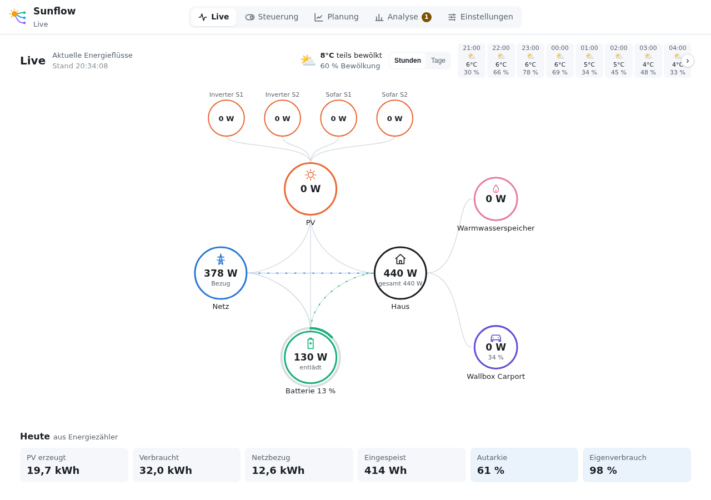
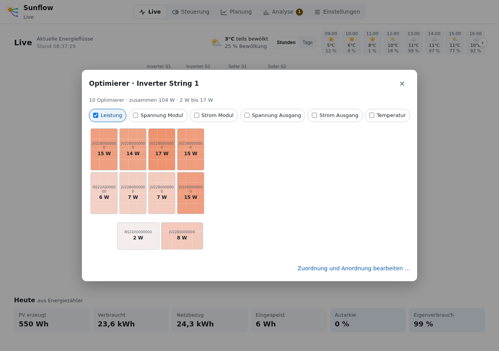
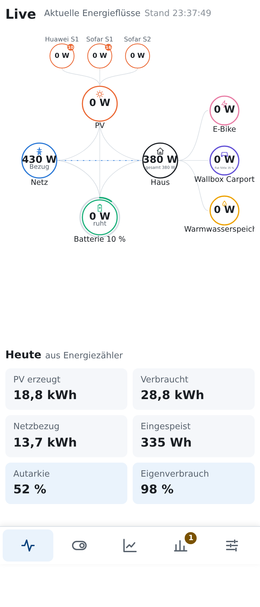
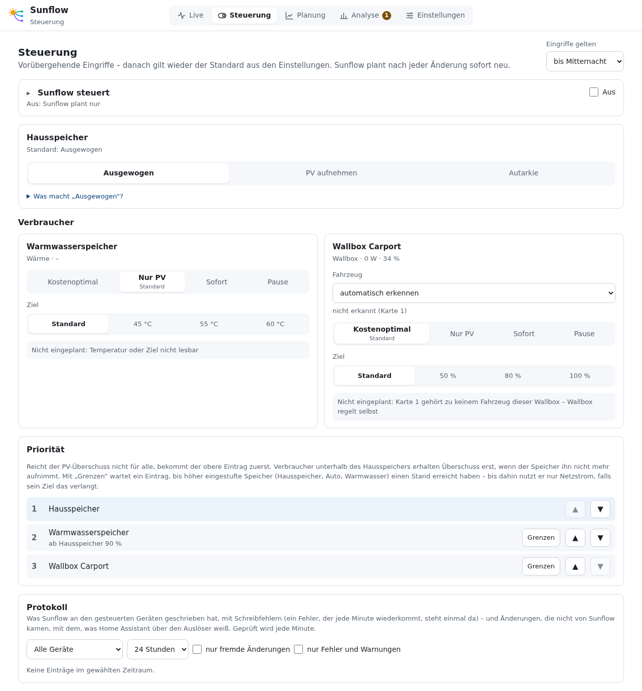
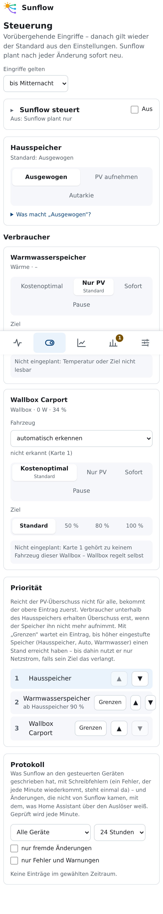
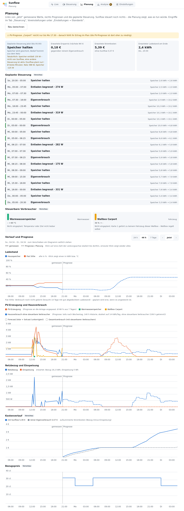
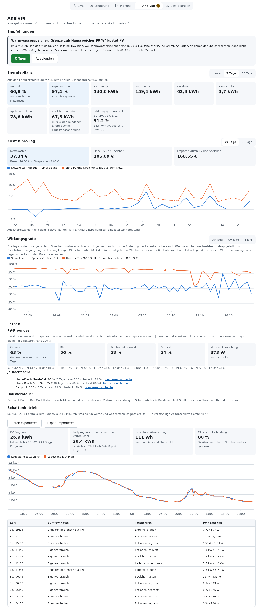

# Bedienung

**Deutsch** · [English](en/user-interface.md)

Oben wählst du eine der fünf Ansichten: **Live**, **Steuerung**, **Planung**, **Analyse** und
**Einstellungen**. Auf dem Handy liegen sie als Symbole am unteren Rand. Eine Zahl an „Analyse“
zeigt offene Empfehlungen.

## Live

Der Energiefluss zeigt, was gerade fließt: PV (oben, mit einem Kreis je String), Netz,
Hausspeicher, Haus und die steuerbaren Verbraucher wie Wallbox und Warmwasser. Bewegte Linien
zeigen, wohin die Energie gerade fließt.

Rechts unter dem Energiefluss wählst du die Ansicht, jeder Browser merkt sich seine. Auf dem Handy
ist das ein Knopf mit dem Symbol der aktuellen Ansicht, der die Auswahl öffnet. Diese Zeile, die
Schnellsteuerung und die Tageswerte bleiben auf dem Handy beim Scrollen unten über der Menüleiste
stehen, solange sie höchstens 60 % des Bildschirms brauchen:

- **Diagramm**: die große Grafik mit Strings und bewegten Linien.
- **Balken**: zwei flache Balken „Woher“ (PV, Speicher, Netzbezug) und „Wohin“ (Haus,
  Verbraucher, Speicher, Einspeisung), jeder über die ganze Breite, mit den Werten darunter; der
  Ladestand des Speichers und ob er lädt steht in der Zeile darunter. Passt neben die Schnellsteuerung.
- **Kacheln**: eine kleine Kachel je Teil und Verbraucher mit Leistung, Zustand und Ladestand;
  zeigt auch mehr als vier Verbraucher.
- **Haus**: die Anlage als bewegtes Bild – Sonne (heller und schneller mit mehr PV) oder Mond und
  Sterne, Wolken nach dem Wetter, Module auf dem Dach, Strommast, Speicher mit Füllstand,
  Warmwasserspeicher in seiner Temperaturfarbe, Carport mit Wallbox und Auto. Leuchtende Ströme
  laufen vom Wechselrichter zu jedem Teil, dicker und schneller mit mehr Leistung. „Bewegung
  reduzieren“ im System schaltet die Bewegung ab.
- **3D**: die Anlage als räumliche Zeichnung mit Beschriftungen wie in einem Prospekt. Bis zu vier
  Dachflächen (Hausdach Süd, die Nordseite angedeutet hinter dem First, Anbau, Carport), bis zu
  zwei Wechselrichter mit je bis zu zwei Speichern darunter, Netzanschluss, bis zu zwei Autos mit
  Wallbox unter dem Carport. Die
  Strings kommen über ihre Prognosefläche auf das Dach: Heißt die Fläche z. B. „Nord…“ oder
  „Carport“, landet sie dort, sonst der Reihe nach. E-Bike (hinten in der Nordecke), Wärmepumpe, Warmwasserspeicher,
  Waschmaschine, Trockner und Herd erscheinen nur, wenn sie als Verbraucher mit Leistungsmessung
  eingerichtet sind (erkannt am Namen); die Geräte im Haus sieht man durchs große Fenster.

- **Haus** zeigt den Verbrauch ohne die steuerbaren Verbraucher, darunter „gesamt“ mit ihnen.
- **Speicher** zeigt Leistung, Richtung und Ladestand; der Ring ist der Ladestand.
- **Wallbox** zeigt Ladeleistung und Ladestand des erkannten Autos.
- **PV-Strings**: Die Zahl am Kreis ist die Anzahl der Optimierer. Ein Klick öffnet die
  Modul-Optimierer des Strings mit ihren aktuellen Werten (siehe [Optimierer](optimierer.md)).

  

Beispiel: Optimierer eines Huawei-Strings

  

  

- **Wetter**: aktuelle Bedingungen und Vorhersage, umschaltbar zwischen Stunden und Tagen;
  wischen oder mit den Pfeilen blättern. Unter [Einstellungen → Anzeige](einstellungen.md#anzeige)
  lässt es sich ausblenden.
- **Schnellsteuerung** (am PC rechts neben dem Energiefluss, der links 60 % der Breite nimmt; auf dem Handy darunter): je Verbraucher, den du unter Steuerung mit der
  Stecknadel angeheftet hast, eine Zeile mit Leistung, Ladestand und nächstem Ladefenster und den
  Betriebsarten als kleine Knöpfe: € Kostenoptimal, PV Nur PV, ⚡ Sofort, ⏸ Pause. Auf dem Handy
  zeigt ein Knopf die aktuelle Betriebsart und öffnet die Auswahl, damit der Name in die Zeile
  passt. Ein Wechsel gilt bis Mitternacht. Bei „Akku laden“ ohne Steckersensor schaltet 🔌 „jetzt eingesteckt“. An der
  Wallbox zeigt ein Knopf mit Auto-Symbol die Auswahl – „erkennen“ oder das gewählte Fahrzeug –
  und öffnet die Liste; 🎯 zeigt das Ziel (Ladestand oder Temperatur) und öffnet einen
  Drehregler für einen beliebigen Wert bis zum
  [höchsten Ziel von Hand](einstellungen.md#verbraucher), „Standard“ (mit seinem Wert) nimmt die
  Änderung zurück. Ohne
  angeheftete Verbraucher erscheint der Block nicht.
- **Heute** fasst die Energiezähler zusammen: PV erzeugt, verbraucht, Netzbezug, eingespeist,
  Verluste von Wechselrichter und Speicher, Autarkie und Eigenverbrauch.
- **Verluste Wechselrichter/Speicher** (unter dem Energiefluss, Mittel der letzten Minuten):
  Bilanz aus PV, Netz und Speicher minus gemessenem Hausverbrauch, also Wandlungsverluste und
  Eigenverbrauch der Geräte. Das Energie-Dashboard von Home Assistant zählt sie zum Hausverbrauch;
  deshalb zeigt es mehr Verbrauch und mehr Autarkie als Sunflow. Nur mit einem Verbrauchszähler
  bzw. einer Verbrauchsmessung.

## Steuerung

Hier greifst du vorübergehend in den Plan ein. Danach gilt wieder der Standard aus den
Einstellungen. **Eingriffe gelten** legt fest, wie lange: bis Mitternacht, 4 Stunden oder bis
auf Weiteres. Nach jeder Änderung plant Sunflow sofort neu.

- **Sunflow steuert**: Hauptschalter und Schalter je Gerät, dazu der Zustand jedes Geräts.
  Zugeklappt zeigt der Abschnitt, wie viele Geräte gesteuert werden und ob eines ein Problem hat.
  Ausführlich unter [Steuerung übernehmen](steuerung.md).
- **Hausspeicher**: Strategie für den Zeitraum (Ausgewogen, PV aufnehmen, Autarkie,
  Speichernutzung; auf dem Handy kurz: Ausgewogen, PV, Autark, Speicher).
  „Was macht …?“ klappt die Erklärung der Strategie auf.
- **Verbraucher**: je Wallbox, Warmwasser oder eigenem Verbraucher die Betriebsart
  (Kostenoptimal, Nur PV, Sofort, Pause) und das Ziel (Ladestand oder Temperatur): Standard,
  eine Vorwahl oder über „±“ ein beliebiger Wert mit dem Drehregler (ziehen, Mausrad,
  Pfeiltasten oder −/+, dann „Übernehmen“). Bei der
  Wallbox wählst du das Fahrzeug oder lässt es erkennen; die gescannte Karte steht in Klammern,
  z. B. „Fiat 500e (Karte 1)“. Mit eingerichtetem Sensor siehst du auch die Spannung der
  12-V-Batterie des Autos. Darunter steht, was der Plan vorsieht oder warum nichts eingeplant ist.
  Die **Stecknadel** oben rechts legt die Betriebsarten des Verbrauchers als Schnellsteuerung auf
  Live; für alle Browser und Geräte.
- **Priorität**: Reicht der PV-Überschuss nicht für alle, bekommt der obere Eintrag zuerst.
  Mit **Grenzen** wartet ein Verbraucher, bis höher stehende Speicher einen Stand erreicht haben,
  z. B. Warmwasser erst ab 90 % Hausspeicher. Bis dahin bekommt er keinen PV- oder Speicherstrom,
  nur Netzstrom, wenn der Plan ihn dafür vorsieht. Die Steuerung prüft die Grenzen bei jedem
  Schritt mit den gemessenen Werten, nicht nur mit der Prognose. Grenzen gehen in 1-%-Schritten.
  Eine Grenze auf den Hausspeicher über seiner Ladegrenze (z. B. 100 % bei 98 %) gilt als
  erreicht, sobald er die Ladegrenze erreicht – sonst wäre sie fast nie erfüllt. Ein Auto hält nur
  zurück, solange es angesteckt ist, nicht unterwegs oder nur erwartet. Ein Auto, das angesteckt,
  aber noch nicht erkannt ist (Ladestand unbekannt), hält wartende Verbraucher zurück.
- **Protokoll**: was Sunflow an Geräte geschrieben hat, mit Grund und Fehlern, und Änderungen
  von anderer Seite mit ihrem Auslöser. Filter nach Gerät, Zeitraum, „nur fremde Änderungen“
  und „nur Fehler und Warnungen“.

## Planung

Links von „jetzt“ stehen gemessene Werte, rechts die Prognose und der Plan.

- **Kopfzeile**: geplante Steuerung jetzt (und was tatsächlich passiert), erwartete Ersparnis
  gegenüber reinem Eigenverbrauch – aufgeteilt in Strom, Ersatzheizung (falls eingestellt) und den
  Wert dessen, was am Planende mehr im Speicher ist –, erwartete Stromkosten und erwarteter
  Ladestand am Planende.
  **Neu berechnen** plant sofort neu.
- **Hinweise** in Gelb, z. B. wenn eine PV-Prognose nicht so weit reicht wie der Plan.
- **Geplante Steuerung**: die Abschnitte des Plans mit Aktion (Eigenverbrauch, Speicher halten,
  Laden aus dem Netz, Entladen begrenzt …) und Ladestand von → bis.
- **Steuerbare Verbraucher**: je Verbraucher Ziel, Zeitpunkt und was eingeplant ist, oder
  warum nicht.
- **Verlauf und Prognose**: Diagramme für Ladestand, PV-Erzeugung und Hausverbrauch,
  Netzbezug und Einspeisung, Kostenverlauf und Bezugspreis.
  - Zeitraum 24 h, 48 h oder 7 Tage; mit ‹ › blättern, **Jetzt** springt zurück.
  - Mit der Maus oder dem Finger seitlich ziehen verschiebt alle Diagramme gemeinsam.
  - Ein Klick auf eine Zahl der Leistungsachse skaliert bis dorthin; erneuter Klick zeigt alles.
  - Ein Klick auf einen Eintrag der Legende im Ladestand-Diagramm zeigt nur diesen in seiner
    Einheit (kWh oder °C) mit seinem Ziel.
  - Gestrichelt ist Prognose oder Plan, durchgezogen ist gemessen. Geschätzte Preise jenseits der
    veröffentlichten sind ebenfalls gestrichelt.
  - Per Häkchen lässt sich die unkorrigierte Prognose der Quelle (Solcast, Forecast.Solar)
    und der Gesamtverbrauch mit steuerbaren Verbrauchern einblenden.

## Analyse

Wie gut stimmen Prognosen und Entscheidungen mit der Wirklichkeit überein?

- **Empfehlungen**: Hinweise, wo eine Einstellung nicht zu den Messwerten passt, z. B. ein zu
  hoch angesetzter Warmwasserbedarf oder ein gemessener Wirkungsgrad des Speichers.
  **Öffnen** führt zur Einstellung, **Ausblenden** verwirft den Hinweis.
- **Energiebilanz**: Autarkie, Eigenverbrauch, PV, Verbrauch, Netz, Speicher und Wirkungsgrad
  für heute, 7 oder 30 Tage, aus den Energiezählern der Geräte.
- **Kosten pro Tag**: Nettokosten (Bezug minus Einspeisung) gegenüber „ohne PV und Speicher“
  und die Ersparnis, über 30 oder 90 Tage.
- **Speicher planen**: rechnet mit deinen gemessenen Netz- und Speicherwerten und dem Preisverlauf
  der letzten 30 Tage, 90 Tage oder eines Jahres durch, was ein Speicher gespart hätte. Je Variante
  gibst du Kapazität, nutzbaren Anteil, Lade- und Entladeleistung, Wirkungsgrad von Speicher und
  Wechselrichter, Kaufpreis und Zyklen (daraus der Verschleiß) an und ob er **zusätzlich** zum
  vorhandenen oder **statt** seiner arbeiten soll. **Vorhandenen Speicher übernehmen** legt deinen
  Speicher mit seinen Werten an, so kannst du andere Einstellungen (Netzladen, Verschleiß,
  Leistung) rückblickend durchrechnen. Jede Variante wird als reiner
  Eigenverbrauch ohne Steuerung gerechnet und gesteuert wie Sunflow mit den Strategien, die du
  über der Tabelle wählst (Ausgewogen, PV aufnehmen, Autarkie, Speichernutzung; jeder Browser
  merkt sich die Auswahl). Die Strategien kennen Preise und Verbrauch im Voraus – eine Obergrenze,
  die keine Planung erreicht. Verschleiß steckt nicht in den Stromkosten; eine Strategie mit mehr
  Zyklen pro Jahr nutzt den Speicher entsprechend stärker ab. Die Tabelle zeigt Bezug, Einspeisung, Stromkosten,
  Ersparnis gegenüber heute, aufs Jahr hochgerechnet (ohne Jahreszeiten), Zyklen pro Jahr und mit
  Kaufpreis die Amortisation. Mit vorhandenem Speicher steht oben zusätzlich **Ohne Speicher**: das
  Haus, wenn es gar keinen Speicher gäbe. Die Spalte „ggü. ohne Speicher pro Jahr“ zeigt, was dein
  heutiger Speicher und jede Variante gegenüber gar keinem sparen; ein negativer Wert heißt, die
  Verluste kosten mehr, als der Speicher einbringt. Hast du beim Verschleiß deines Speichers einen
  Kaufpreis angegeben, steht bei „Gemessen“ seine Amortisation gegenüber gar keinem Speicher. Mit Stundenwerten ist die Ersparnis etwas zu hoch, weil Bezug und
  Einspeisung innerhalb einer Stunde verrechnet werden. Sunflow steuert dabei nichts.
- **Wirkungsgrade**: Speicher und Wechselrichter über 30 Tage, 90 Tage oder ein Jahr.
- **Lernen**: wie gut die PV-Prognose ankommt (gesamt, je Bewölkung, je Stunde, je Fläche) und
  wie weit das Modell für den Hausverbrauch ist. Je Dachfläche setzt „Neu lernen ab heute“ das
  Lernen zurück, z. B. nach einem Baumschnitt. Schnee, Laub und Säubern erkennt Sunflow selbst im
  Vergleich mit den anderen Flächen und zeigt es bei der Fläche an (siehe
  [Planung](planung.md#lernen)).
- **PV je Fläche**: je Dachfläche die gemessenen Strings gegen die rohe Solcast-Prognose, stündlich
  über die letzten 3, 7 oder 14 Tage, und rechts davon die rohe Prognose mit Bandbreite (p10 bis p90)
  und was Sunflow nach dem Gelernten erwartet. Darüber der Anteil: wie viel der Rohprognose
  gemessen wurde und wie viel Sunflow für die nächsten Tage erwartet. Die Planung rechnet je nach
  [PV-Risiko](einstellungen.md#planung) noch etwas vorsichtiger.
- **PV nach Sonnenstand (Test)**: lernt je Dachfläche aus den vergangenen Solcast-Prognosen und den
  gemessenen Strings, wie viel der Prognose je Sonnenhöhe und -richtung ankommt, getrennt nach klar
  und bewölkt. Dazu lernt es, wie weit die Messung bei unsicherer Prognose (p10 weit unter dem
  Mittelwert, etwa bei Hochnebel) Richtung p10 liegt; das nutzt die Planung nur, wo es im Backtest
  besser ist. Die Verschattungskarte zeigt orange, wo weniger ankommt (Schatten), blau, wo mehr.
  Der Backtest lernt ohne die letzten 3 Wochen und vergleicht auf diesen die Abweichung je Stunde
  mit der Rohprognose und mit der Korrektur nach Uhrzeit. Die Planung nutzt es erst, wenn es unter Einstellungen →
  Planung eingeschaltet ist, und nur für Flächen mit mindestens 60 Tagen und besserem Backtest.
  Liefert eine Fläche mehrere Tage am Stück deutlich weniger als sonst bei diesem Sonnenstand
  (ohne eigene Historie: weniger als die Hälfte der Prognose), erscheint ein Hinweis auf Laub,
  Schnee oder Schmutz; diese Tage lernt Sunflow nicht mit. Liefert eine Fläche mit Modell in den
  letzten Tagen unter 90 % des Gelernten (z. B. Herbstlaub), plant Sunflow mit dieser geringeren
  Leistung und stellt sich von selbst wieder um, sobald sie mehr liefert (alle 3 Stunden geprüft).
  „Neu lernen ab heute“ verwirft auch die Historie nach Sonnenstand, deshalb nur nach Baumschnitt
  oder Modultausch, nicht nach dem Säubern.
- **Datenbestand fürs Lernen**: wie weit Home Assistant zurück aufhebt, woraus Sunflow lernen
  kann: Verlauf in voller Auflösung (Aufbewahrung des Recorders), Langzeitstatistik, Wetter mit
  oder ohne Bewölkung und die vergangenen Solcast-Prognosen. Darunter je Messwert, seit wann er
  vorliegt und wie oft er sich ändert, auch je Optimierer (Leistung und Temperatur je Modul). Geprüft wird höchstens stündlich; **Neu prüfen** fragt sofort.
- **Schattenbetrieb**: Sunflow zeichnet alle 15 Minuten auf, was es tun würde und was
  tatsächlich passiert ist. Die Kacheln vergleichen PV- und Lastprognose mit der Messung, das
  Diagramm den tatsächlichen Ladestand mit dem, den der Plan **6 Stunden vorher** erwartet hat
  (jeder neue Plan startet beim gemessenen Ladestand, der jüngste läge deshalb immer fast genau auf
  der Messung). Werte gibt es ab 0.78.33. Die Tabelle zeigt die Abschnitte, in
  denen die Entscheidung abwich. Hier liegen auch **Daten exportieren** und **Export importieren**.
