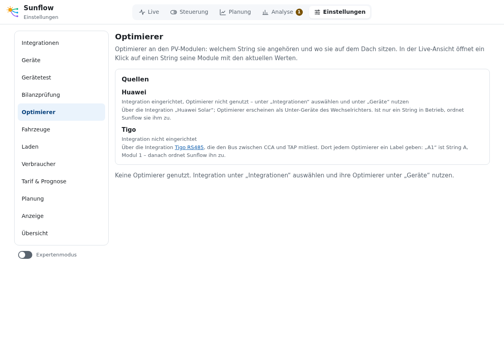
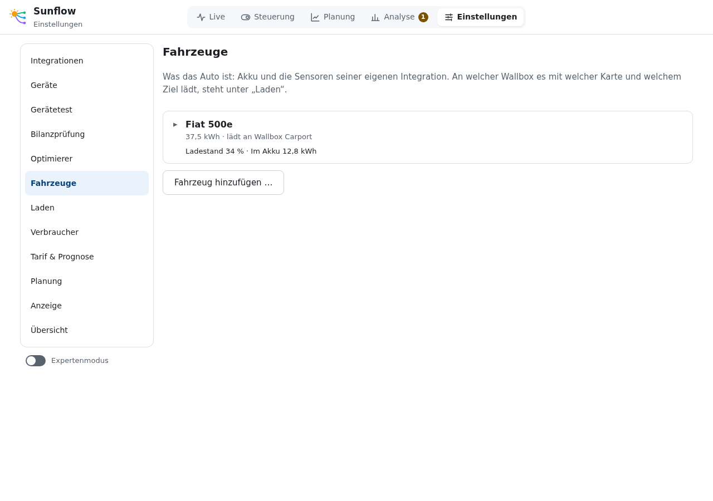
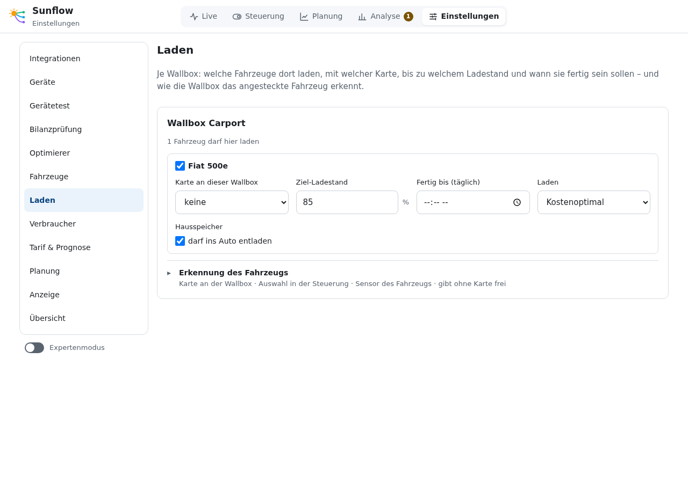
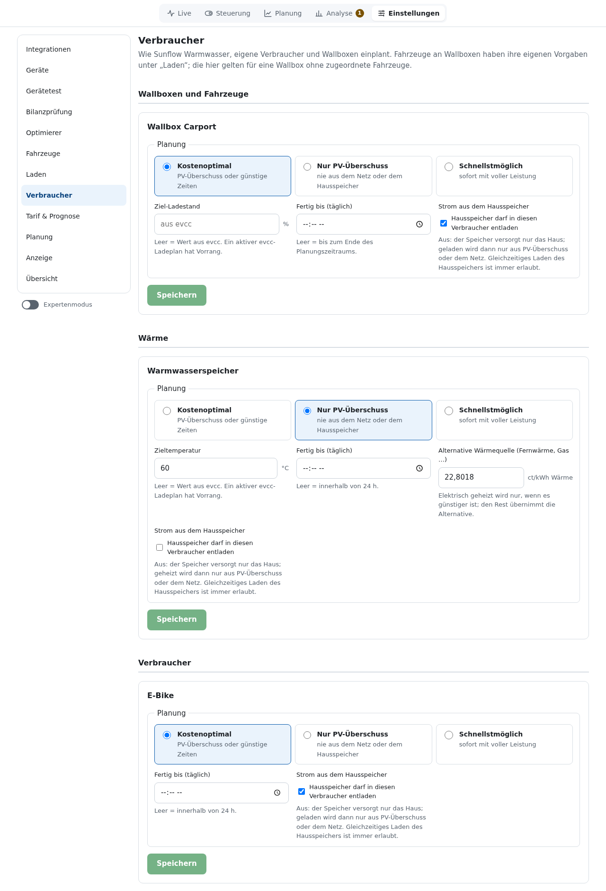
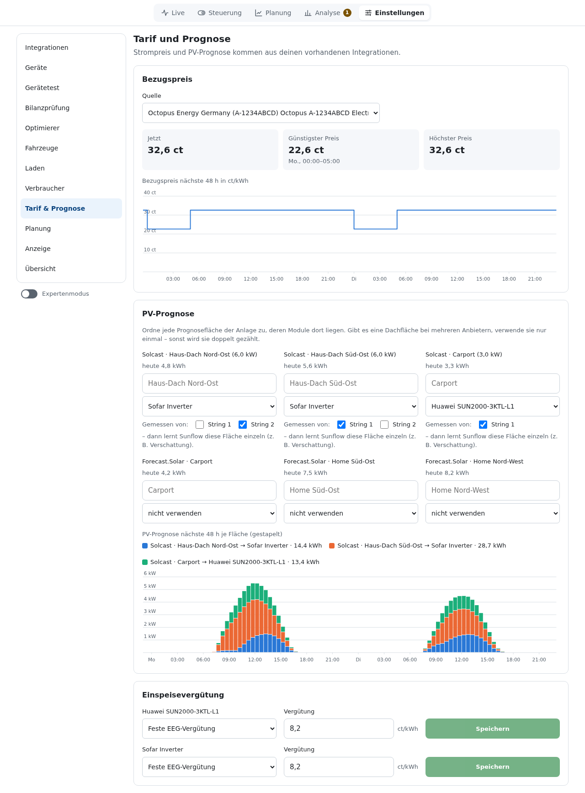
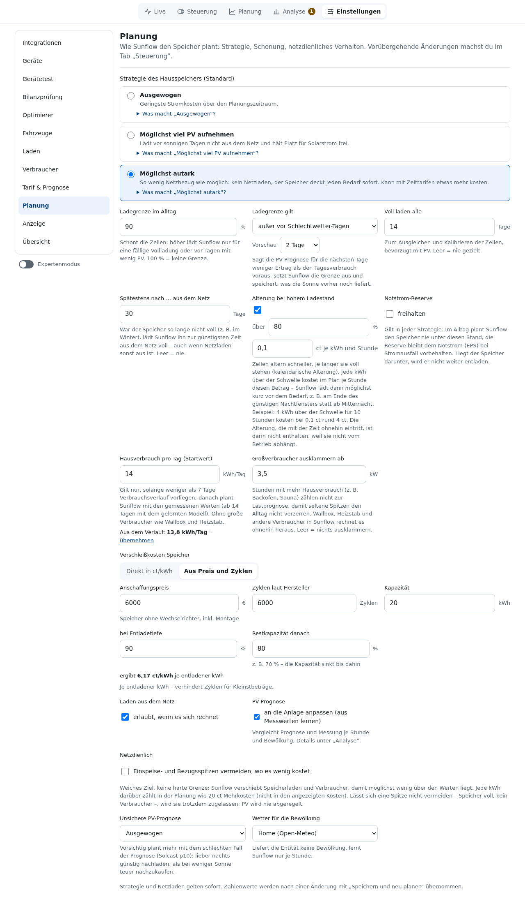
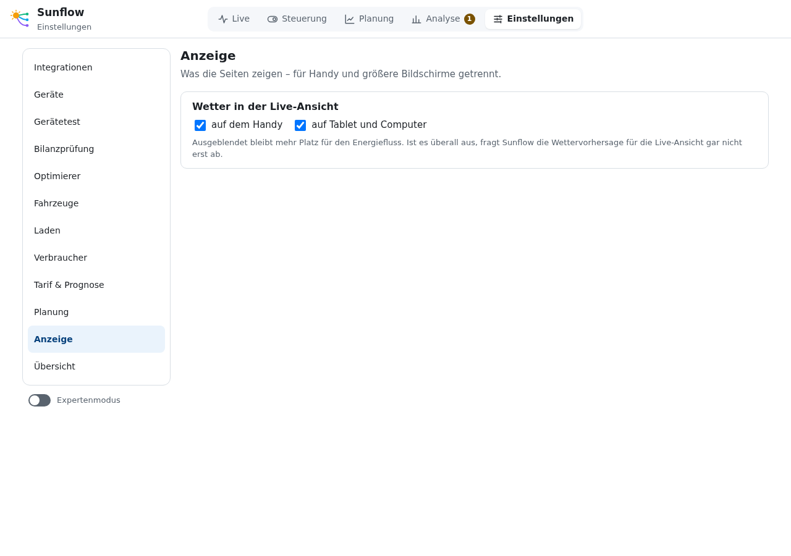

# Einstellungen

**Deutsch** · [English](en/settings.md)

Die Einstellungen sind in Bereiche gegliedert; beim ersten Start führt Sunflow der Reihe nach
durch sie (siehe [Installation und Einrichtung](installation.md)). Ungespeicherte Änderungen
eines Bereichs bleiben erhalten, wenn du zu einem anderen wechselst.

**Suche** (Feld über der Liste) findet eine Einstellung nach ihrem Namen, nach anderen Wörtern
dafür („Akku“, „Notstrom“, „Tibber“, „Einspeisegrenze“) und trotz Tippfehlern, außerdem deine
Geräte nach Namen. Ein Treffer öffnet den Bereich, scrollt zur Einstellung und hebt sie kurz
hervor. Pfeiltasten und Enter wählen, Esc leert das Feld.

**Expertenmodus** (Schalter unter der Liste) zeigt zusätzlich je Rolle Entität, Einheit, Faktor,
Vorzeichen, Nachkommastellen, Abfrageintervall und RAM/Flash. Diese Werte werden als
Abweichung vom Profil gespeichert. Der Browser merkt sich den Schalter.

## Integrationen, Geräte, Gerätetest, Bilanzprüfung

Beschrieben unter [Installation und Einrichtung](installation.md).

## Optimierer

Quellen, Anordnung auf dem Dach und Zuordnung der Modul-Optimierer: siehe [Optimierer](optimierer.md).

## Fahrzeuge

Was das Auto ist, unabhängig von der Wallbox:

- **Name**, **Akkukapazität (nutzbar)** und **Ladewirkungsgrad**.
- **Ladestand**: der Sensor aus der Integration des Autos.
- **Angesteckt / zuhause** (optional, z. B. ein `device_tracker`): Damit lernt Sunflow, wann das
  Auto üblicherweise heimkommt und wegfährt, und plant es ein, sobald es zu Hause ist. Ohne
  Sensor gelten die Steckzeiten an der Wallbox.
- **Höchste Ladeleistung** einphasig und dreiphasig (z. B. Fiat 500e: 7,4 kW / 11 kW). Sunflow
  gibt der Wallbox nicht mehr Strom vor, als das Auto nimmt, und plant mit dieser Leistung.
- **12-V-Batterie schützen**: Mit dem Spannungssensor des Autos lädt die Wallbox kurz mit
  kleinstem Strom, wenn die Bordnetzbatterie unter die Grenze fällt (Vorgabe 12,2 V, 5 min
  laden, danach mindestens 60 min Pause). Einzelheiten unter [Unterstützte Geräte](geraete.md).

Sunflow lernt aus dem Ladestand-Verlauf der letzten vier Wochen, wie viel das Auto je Stunde
verbraucht (Werktag und Wochenende getrennt, ab 14 Tagen mit Daten).

## Laden

Je Wallbox:

- **Welche Fahrzeuge** hier laden dürfen.
- **Karte an dieser Wallbox**: Die RFID-Karte, mit der das Fahrzeug erkannt wird.
- **Ziel-Ladestand** und **Fertig bis (täglich)**.
- **Laden**: Kostenoptimal, Nur PV-Überschuss oder Schnellstmöglich.
- **Hausspeicher darf ins Auto entladen**: Aus heißt, das Auto lädt nur aus PV-Überschuss oder dem Netz.
- **Erkennung des Fahrzeugs**: in welcher Reihenfolge Sunflow das angesteckte Auto erkennt
  (Karte an der Wallbox, Auswahl in der Steuerung, Sensor des Fahrzeugs) und ob die Wallbox
  ohne Karte freigibt.

## Verbraucher

Standard-Vorgaben für Wallboxen ohne zugeordnete Fahrzeuge, Warmwasser und eigene Verbraucher:

- **Planung**: Kostenoptimal (PV-Überschuss oder günstige Zeiten), Nur PV-Überschuss (nie aus
  dem Netz oder dem Hausspeicher) oder Schnellstmöglich (sofort mit voller Leistung).
- **Ziel**: Ladestand oder Temperatur; leer übernimmt Sunflow den Wert aus evcc. Ein aktiver
  evcc-Ladeplan hat Vorrang.
- **Fertig bis (täglich)**: leer heißt bis zum Ende des Plans bzw. innerhalb von 24 h.
- **Strom aus dem Hausspeicher**: ob der Speicher in diesen Verbraucher entladen darf.
- **Alternative Wärmequelle** (Warmwasser): Preis je kWh Wärme aus Fernwärme, Gas o. Ä.
  Elektrisch geheizt wird nur, wenn es günstiger ist.

Sunflow lernt, wann und wie viel Warmwasser verbraucht wird (je Stunde, Werktag und Wochenende
getrennt, ab einer Woche Daten), und heizt ohne eingestellte Bereitzeit bis zur gewohnten
Hauptverbrauchszeit.
Erwärmt sich der Speicher regelmäßig ohne den eigenen Heizstab (Fernwärme, Gas), lernt Sunflow
die Temperatur, bei der diese Wärmequelle einsetzt; die Temperatur-Prognose fällt nicht darunter.

## Tarif & Prognose

Bezugspreis, PV-Prognose je Fläche und Einspeisevergütung je Wechselrichter. Siehe
[Installation und Einrichtung](installation.md#6-tarif--prognose) und [Strompreise](strompreise.md).

## Planung

Wie Sunflow den Hausspeicher plant. Hintergründe stehen unter [So plant Sunflow](planung.md).

| Einstellung | Bedeutung |
|---|---|
| Strategie | Ausgewogen, Möglichst viel PV aufnehmen, Möglichst autark oder Speichernutzung. „Was macht …?“ klappt die Erklärung auf. |
| Ladegrenze im Alltag | Höher lädt Sunflow nur für eine fällige Vollladung. 100 % = keine Grenze. |
| Voll laden alle … Tage | Zum Ausgleichen und Kalibrieren der Zellen, bevorzugt mit PV. Leer = nie gezielt. |
| Spätestens nach … aus dem Netz | War der Speicher so lange nicht voll (z. B. im Winter), lädt Sunflow ihn zur günstigsten Zeit aus dem Netz voll. |
| Alterung bei hohem Ladestand | Jede kWh über der Schwelle (Vorgabe 80 %) kostet je Stunde einen kleinen Betrag (Vorgabe 0,1 ct). Sunflow lädt dann möglichst kurz vor dem Bedarf. Abschaltbar. |
| Notstrom-Reserve | Gilt in jeder Strategie: Im Alltag plant Sunflow den Speicher nie unter diesen Stand. |
| Hausverbrauch pro Tag | Startwert, solange weniger als 7 Tage Verlauf vorliegen. |
| Großverbraucher ausklammern ab | Stunden mit mehr Hausverbrauch (z. B. Backofen, Sauna) zählen nicht zur Lastprognose. Steuerbare Verbraucher rechnet Sunflow ohnehin heraus. |
| Verschleißkosten Speicher | Je Speicher unter Geräte → Speicher: direkt in ct/kWh oder aus Anschaffungspreis, Zyklen, Entladetiefe und Restkapazität berechnet; dazu der Schalter „In der Planung berücksichtigen“. Verhindert Zyklen für Kleinstbeträge. |
| Laden aus dem Netz | Erlaubt, wenn es sich rechnet. |
| PV-Prognose anpassen | Lernt aus Messwerten je Stunde und Bewölkung, Details unter Analyse. |
| Nach Sonnenstand korrigieren (Test) | Für Flächen mit Solcast-Historie: Korrektur je Sonnenhöhe und -richtung, aus bis zu zwei Jahren gelernt (einmal am Tag); erkennt Verschattung, die mit der Jahreszeit wandert. Ersetzt die Korrektur nach Uhrzeit für Flächen, deren Modell aus mindestens 60 Tagen gelernt hat und im Backtest besser ist. Backtest und Verschattungskarte unter Analyse. |
| Netzdienlich | Einspeise- und Bezugsspitzen über den eingestellten Grenzen vermeiden, wo es wenig kostet. Ein weiches Ziel, keine harte Grenze. |
| Unsichere PV-Prognose | Vorsichtig plant mehr mit dem schlechten Fall der Prognose (Solcast p10). |
| Wetter für die Bewölkung | Wetter-Entität für das Lernen je Bewölkung. |

Strategie und Netzladen gelten sofort. Zahlenwerte übernimmt **Speichern und neu planen**.

**Lernquellen** (optional): Zusätzliche Sensoren machen die gelernten Prognosen genauer. Keiner
ist nötig. Sunflow schlägt Sensoren anhand ihrer Geräteklasse oder Einheit vor; die eigenen
Temperaturen von Wechselrichter und Speicher stehen nicht in der Liste. Unter jeder Auswahl steht,
wie weit Home Assistant die Werte zurück aufhebt. Sensoren ohne `state_class` haben keine
Langzeitstatistik, nur den Verlauf des Recorders.

Jede gewählte Quelle wird auf Plausibilität geprüft (bis zu 100 Tage). Werte außerhalb des
physikalisch Möglichen, kurze Ausreißer gegenüber den Nachbarwerten und Werte, die sich
unplausibel lange nicht ändern (hängender Sensor), lässt das Lernen weg; Ausfälle bis 30 Minuten
werden überbrückt, längere bleiben Lücken. Zeiten, in denen Home Assistant selbst nicht
aufgezeichnet hat (erkannt an der Netzleistung), zählen nicht mit, bei Optimierern auch nicht die
Zeit mit der Sonne unter 5° (sie schlafen ohne Licht). Unter der Auswahl steht der
plausible Anteil; unter 80 % ist er hervorgehoben. In Home Assistant ändert sich nichts.

| Quelle | Wofür |
|---|---|
| Außentemperatur | Im Schatten gemessen; Heizanteil am Hausverbrauch und Modultemperatur. Ohne: Temperatur der Wetter-Entität. |
| Luftfeuchte draußen | Mit der Temperatur: Tau und Reif auf den Modulen. |
| Helligkeit oder Einstrahlung | Wie hell es tatsächlich war (lx oder W/m²); trennt Wolken von Verschattung, auch rückwirkend. |
| Niederschlag | Erkennung von Schnee auf den Modulen. |
| Modultemperatur je Dachfläche | Warme Module liefern weniger. Hat die Fläche Optimierer (über ihre Strings zugeordnet), nimmt Sunflow ohne eigene Wahl das Mittel ihrer Temperaturen; sonst aus Außentemperatur und Einstrahlung geschätzt. |

## Anzeige

- **Wetter in der Live-Ansicht**: für Handy und für Tablet/Computer getrennt ausblendbar. Ist es
  überall aus, fragt Sunflow die Wettervorhersage dafür nicht ab.
- **Sprache**: „Wie Home Assistant“ (Standard: Deutsch, wenn Home Assistant auf Deutsch steht, sonst
  Englisch), „Deutsch“ oder „English“. Gilt für die Oberfläche und für Meldungen wie Planhinweise
  und Empfehlungen. Die Seite lädt danach neu.

## Übersicht

Fasst Geräte, Tarif und Prognose zusammen und markiert, was noch fehlt (siehe
[Installation und Einrichtung](installation.md#8-übersicht)).
