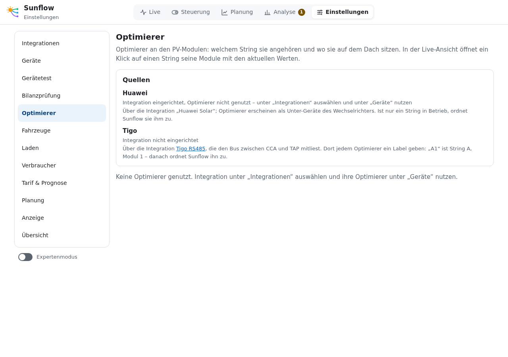
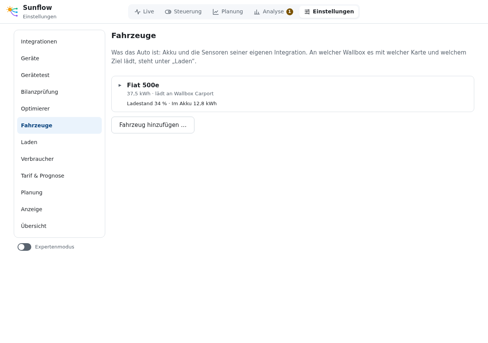
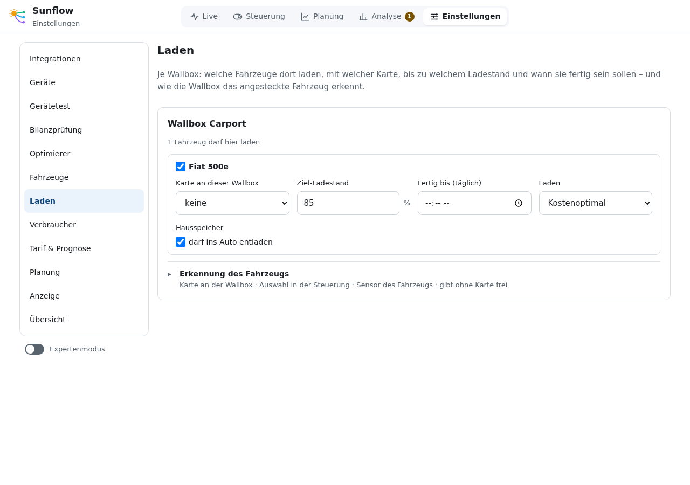
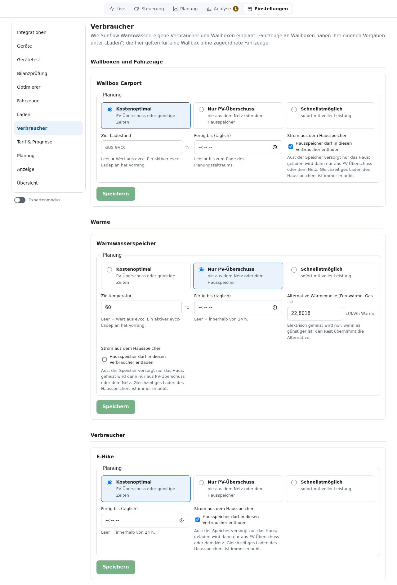
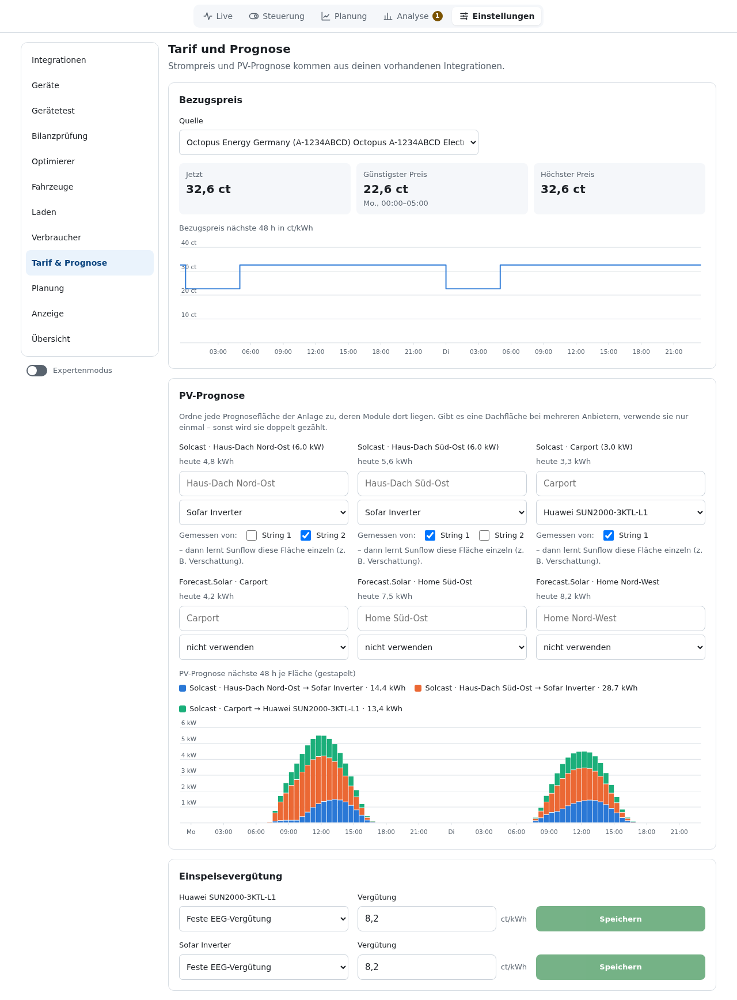
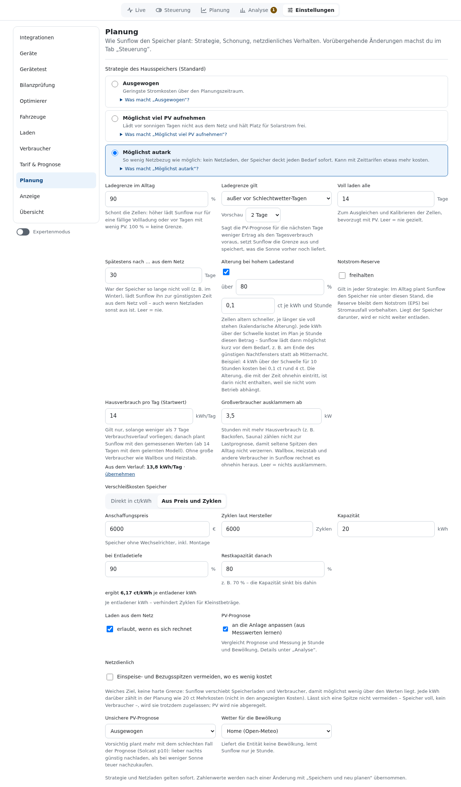
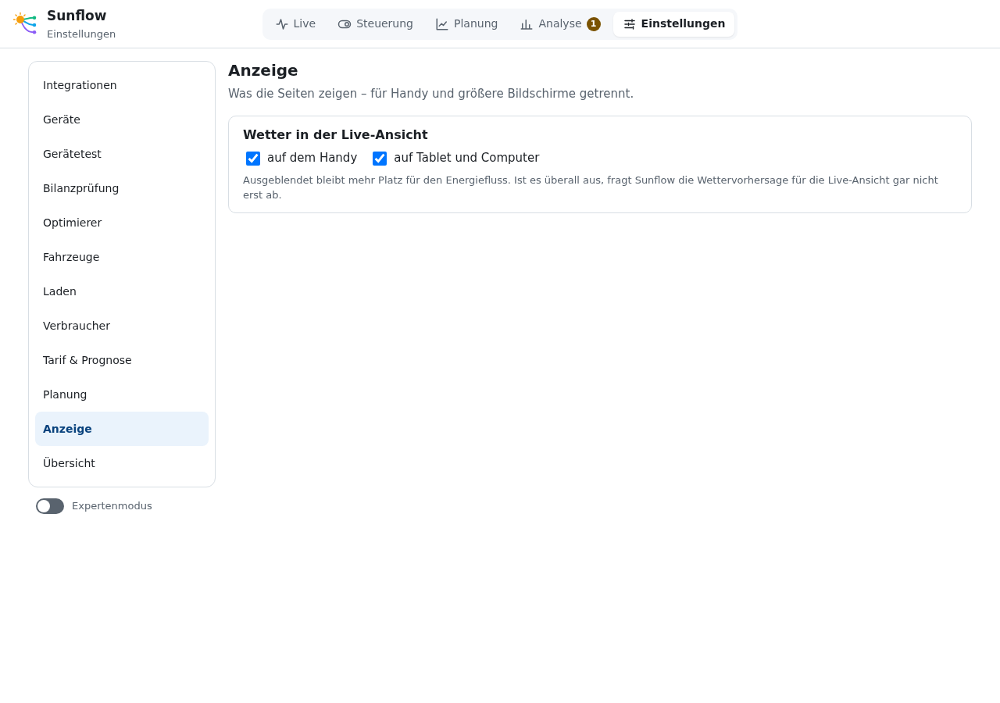

# Einstellungen

**Deutsch** · [English](en/settings.md)

Die Einstellungen sind in Bereiche gegliedert; beim ersten Start führt Sunflow der Reihe nach
durch sie (siehe [Installation und Einrichtung](installation.md)). Ungespeicherte Änderungen
eines Bereichs bleiben erhalten, wenn du zu einem anderen wechselst.

**Suche** (Feld über der Liste) findet eine Einstellung nach ihrem Namen, nach anderen Wörtern
dafür („Akku“, „Notstrom“, „Tibber“, „Einspeisegrenze“) und trotz Tippfehlern, außerdem deine
Geräte nach Namen. Ein Treffer öffnet den Bereich, scrollt zur Einstellung und hebt sie kurz
hervor. Pfeiltasten und Enter wählen, Esc leert das Feld.

**Expertenmodus** (Schalter unter der Liste) zeigt zusätzlich je Rolle Entität, Einheit, Faktor,
Vorzeichen, Nachkommastellen, Abfrageintervall und RAM/Flash. Diese Werte werden als
Abweichung vom Profil gespeichert. Der Browser merkt sich den Schalter.

## Integrationen, Geräte, Gerätetest, Bilanzprüfung

Beschrieben unter [Installation und Einrichtung](installation.md).

## Optimierer

Quellen, Anordnung auf dem Dach und Zuordnung der Modul-Optimierer: siehe [Optimierer](optimierer.md).

## Fahrzeuge

Was das Auto ist, unabhängig von der Wallbox:

- **Name**, **Akkukapazität (nutzbar)** und **Ladewirkungsgrad**.
- **Ladestand**: der Sensor aus der Integration des Autos. **Zwischen den Meldungen berechnen**
  (standardmäßig an): Viele Autos senden ihren Ladestand nur ab und zu, z. B. ein Fiat 500e über
  die Cloud. Dazwischen zählt Sunflow dazu, was die Wallbox seitdem in dieses Auto geladen hat.
  Mit jeder neuen Meldung vergleicht Sunflow die Rechnung mit dem echten Wert und lernt, wie viel
  der Energie an der Wallbox im Akku ankommt (zunächst der Ladewirkungsgrad, dann gelernt, die
  letzten etwa 60 kWh zählen). Gelernt wird nur aus Meldungen nach mindestens 1,5 kWh, nicht bei
  100 % und nicht, wenn das Auto zwischendurch gefahren ist. Berechnete Werte stehen mit „≈“, die
  Karte des Fahrzeugs zeigt die letzte Meldung, was seitdem geladen wurde und was gelernt ist.
- **Angesteckt / zuhause** (optional, z. B. ein `device_tracker`): Damit lernt Sunflow, wann das
  Auto üblicherweise heimkommt und wegfährt, und plant es ein, sobald es zu Hause ist. Ohne
  Sensor gelten die Steckzeiten an der Wallbox.
- **Höchste Ladeleistung** einphasig und dreiphasig (z. B. Fiat 500e: 7,4 kW / 11 kW). Sunflow
  gibt der Wallbox nicht mehr Strom vor, als das Auto nimmt, und plant mit dieser Leistung.
- **12-V-Batterie schützen**: Mit dem Spannungssensor des Autos lädt die Wallbox kurz mit
  kleinstem Strom, wenn die Bordnetzbatterie unter die Grenze fällt (Vorgabe 12,2 V, 5 min
  laden, danach mindestens 60 min Pause). Einzelheiten unter [Unterstützte Geräte](geraete.md).

Sunflow lernt aus dem Ladestand-Verlauf der letzten vier Wochen, wie viel das Auto je Stunde
verbraucht (Werktag und Wochenende getrennt, ab 14 Tagen mit Daten).

## Laden

Je Wallbox:

- **Welche Fahrzeuge** hier laden dürfen.
- Je Fahrzeug **Ziel-Ladestand**, **Fertig bis (täglich)**, **Laden** (Kostenoptimal, Nur
  PV-Überschuss oder Schnellstmöglich) und ob der **Hausspeicher ins Auto entladen** darf (aus:
  das Auto lädt nur aus PV-Überschuss oder dem Netz). Diese Werte gelten, wenn das Auto ohne
  Karte erkannt wird (Sensor, Auswahl in der Steuerung, einziges Fahrzeug).
- **Karten** (bei Wallboxen mit RFID): Einem Fahrzeug lassen sich mehrere Karten zuordnen, jede
  mit eigener Nummer, eigenem Namen und eigenen Werten wie oben. Wird eine Karte gescannt, gelten
  ihre Werte, z. B. eine Karte „Urlaub“ mit 100 % bis 7:00 und eine Karte „Alltag“ mit 80 %. Ihr
  Name steht überall dort, wo sonst „Karte 3“ stünde. Eine Nummer gehört an einer Wallbox zu
  höchstens einer Karte. Erkennt Sunflow das Auto ohne Karte und gibt die Wallbox frei, nimmt es
  dafür die erste Karte des Fahrzeugs.
- **Erkennung des Fahrzeugs**: in welcher Reihenfolge Sunflow das angesteckte Auto erkennt
  (Karte an der Wallbox, Auswahl in der Steuerung, Sensor des Fahrzeugs) und ob die Wallbox
  ohne Karte freigibt.

## Wärmepumpe

Die Regelung der Wärmepumpe läuft im **Schattenbetrieb**: Sunflow rechnet den Vorlauf aus und zeigt
ihn an, schreibt aber nichts an die Wärmepumpe.

**Raum-Soll:** die Raumtemperatur, die Sunflow halten soll (18–27 °C), und der Modus Heizen/Aus; dasselbe
wie das Thermostat „Haus“ in Home Assistant. Daneben das Raum-Ist (gewichtetes Mittel der Räume; ein Raum
zählt nicht, wenn sein Sensor nicht verfügbar ist oder seit über 2 Stunden nichts gemeldet hat).

**Lüften:** Fällt ein Raum innerhalb von 30 Minuten um mindestens 0,3 K, erkennt Sunflow Lüften. Bis der
Raum wieder gleichmäßig ist (30 Minuten lang höchstens 0,1 K Änderung), höchstens 2 Stunden, zählt er
nicht für das Raum-Ist, und die Korrektur hält an. Angezeigt werden gerade gelüftete Räume und das
Lüften der letzten 24 Stunden.

**Wärmepumpe:** je Gerät Verbindung und Kompatibilität, Programm, Aktivität, Strategie (HK-Funktion),
Bypass-Ventil, Vorlauf, Rücklauf, wirksamer Vorlauf-Soll und Max T-Vorlauf, eine aktive
Raumthermostat-Sperre oder Störung deutlich hervorgehoben, und ob die Wärmepumpe gültig heizt – sonst
der Grund (z. B. Warmwasser, Nachlauf, Bypass-Ventil). Darunter das **Vorlauf-Ziel** = Basis +
Korrektur: Die Basis ist der wirksame Vorlauf-Soll aus gültigem Heizbetrieb (außerhalb gilt der letzte
solche Wert). Die Korrektur gleicht die Abweichung des Raum-Ist vom Raum-Soll langsam aus (höchstens
± 3 K; unter ± 0,2 K Abweichung wächst sie nicht); wie langsam, hängt vom Heizflächentyp ab
(Nachstellzeit: Fußboden 6 h, gemischt 4 h, Heizkörper 2 h). Sie hält an, solange die Wärmepumpe nicht gültig heizt,
Raumtemperaturen fehlen, gelüftet wird oder der Raum einem geänderten Raum-Soll noch folgt (höchstens
24 Stunden). Im
Schattenbetrieb wirkt sie nicht zurück und kann bis an ihre Grenze laufen.

**Kennlinie (Schatten):** Aus den 5-Minuten-Werten lernt Sunflow stündlich, wie viel Wärme die
Heizflächen abgeben: Q = K · (mittlere Wassertemperatur − Raum-Ist)^n, dazu die Spreizung (Vorlauf −
Rücklauf) abhängig von der Wärme. n kommt aus dem **Heizflächentyp** (Fußboden 1,1, gemischt 1,2,
Heizkörper 1,3), K und die Spreizung werden gelernt – nur aus gültigem Heizbetrieb mit seit mindestens
15 Minuten laufendem Kompressor, ohne Nachlauf und ohne Lüften. Die letzten zwei Tage werden
zurückgehalten: Die Kennlinie gilt erst als nutzbar, wenn sie dort den Vorlauf besser vorhersagt als
„der Vorlauf bleibt“, ihre Werte plausibel sind und genug Daten vorliegen (mindestens 12 Stunden aus
3 Tagen zum Lernen und 2 Stunden zum Prüfen). Angezeigt werden K, n, Spreizung, Güte und Datenumfang.

Ist die Kennlinie nutzbar, ist das Vorlauf-Ziel = Kennlinie + Korrektur: der Vorlauf, mit dem die
Heizflächen beim Raum-Soll die benötigte Wärme abgeben. Die benötigte Wärme kommt aus dem Hausmodell
(sobald es nutzbar ist), sonst aus der mittleren Wärme der letzten 3 Stunden (Pausen des Kompressors
zählen mit 0; Warmwasser, Abtauen, Nachlauf, Lüften und Sperre zählen nicht; mindestens 2 Stunden
nötig). Diese Wärme entsteht aus dem Vorlauf, den die Wärmepumpe gerade fährt – die Kennlinie bildet
dann nur den aktuellen Zustand nach, die Richtung gibt die Korrektur. Sonst gilt weiter Basis +
Korrektur. Angezeigt wird, welche Quelle gerade gilt; wechselt sie, springt das Vorlauf-Ziel im
Schattenbetrieb einmal, die Korrektur bleibt.

**Stellwert und Schutz (Schatten):** Aus dem Vorlauf-Ziel rechnet Sunflow den Stellwert (Max T-Vorlauf),
den es schreiben würde, und die Raumthermostat-Sperre – angezeigt mit „würde schreiben“, nichts davon
geht an die Wärmepumpe. Der Stellwert bleibt in den **Grenzen des Stellwerts**, die je Wärmepumpe
einstellbar sind (Mindestens/Höchstens; Höchstens ist zugleich der höchste Vorlauf für Estrich bzw.
Heizflächen). Leer gilt der Startwert des Heizflächentyps (Fußboden 25–40 °C, gemischt 25–50 °C,
Heizkörper 30–55 °C); der Bereich der Entity engt immer weiter ein. Ein Vorlauf-Ziel, das mehr als 8 K
vom wirksamen Vorlauf-Soll (bzw. der Kennlinie) abweicht, würde nicht geschrieben (Eintrag im Journal).
Erreicht das Vorlauf-Ziel eine Grenze oder die Wärmepumpe ihre Höchst- bzw. Mindestleistung, läuft die
Korrektur nicht weiter darüber hinaus.

Die Wärmepumpe schaltet den Kompressor ein, wenn der Soll mindestens 3 K über dem Vorlauf liegt, und aus,
wenn der Vorlauf 3 K über dem Soll liegt. Sunflow würde deshalb: in einer Pause den Stellwert so anheben,
dass die Wärmepumpe startet (Vorlauf + 3 K, bzw. so, dass der Sprung des Vorlaufs nach dem Start nicht
abschaltet); während Warmwasser den Stellwert für den Start danach vorbereiten; nach einem Start halten,
bis der Vorlauf ruhig ist, und dann einmal absenken; im Betrieb nachführen, wenn der Vorlauf der
Abschaltgrenze nahekommt. Wärme, die es nicht will (Raum 0,5 K über dem Raum-Soll, oder die
Mindestleistung der Wärmepumpe liegt über dem Bedarf), würde es über die Raumthermostat-Sperre
abschalten – jeder Zustand mindestens 20 Minuten. Eine Raumthermostat-Sperre, die nicht Sunflow gesetzt
hat (von Hand, eine Automation, ein anderer Regler), hebt Sunflow nicht auf: Sie wird im Bereich
Wärmepumpe deutlich angezeigt und im Journal vermerkt, und Sunflow regelt erst wieder, wenn sie
aufgehoben ist. Die Schwankung des Vorlaufs im Betrieb, der Sprung nach
einem Start (normal, nach Warmwasser, nach Abtauen), die Zeit bis zur Ruhe und der Leistungsbereich der
Wärmepumpe werden aus der Aufzeichnung gelernt; bis genug Daten da sind, gelten vorsichtige Startwerte.
Schaltet der Kompressor ungewollt ab (Vorlauf 3 K über dem Soll ohne Sperre, Warmwasser oder Abtauen),
steht das im Journal, und der betroffene Wert wird sofort erhöht; ohne weitere Vorfälle sinkt er über
Wochen zurück. Die Tabelle **Schreibvorgänge je Tag** zählt für die letzten 7 Tage, was Sunflow
geschrieben hätte (normal, Start, Nachführen, Sperre an/aus), und die ungewollten Abschaltungen – zum
Vergleich mit dem geplanten Budget von 48 normalen und 24 Schreibvorgängen für Start und Nachführen je
Tag. Schon im Schatten gilt dabei der **Mindestabstand** zwischen zwei Schreibvorgängen auf den Stellwert
(aus dem Geräteprofil, bei der HPSU 5 Minuten, für Schutzschritte – Start und Nachführen – 2 Minuten): Die
erste Änderung nach einer Ruhepause geht sofort hinaus, weitere Änderungen in dieser Zeit merkt Sunflow
nur, und nach Ablauf schreibt es den letzten Wert, falls er noch abweicht (ein normaler Wert um mehr als
0,5 K, ein Schutzschritt bei jeder Anhebung). Ein wartender Wert wird als „ausstehend … würde um …
geschrieben“ angezeigt. Ebenso gilt schon im Schatten das **Budget** (aus dem Geräteprofil, bei der HPSU
48 Schreibvorgänge je Tag, dazu 24 nur für Schutzschritte, höchstens 6 in jeder Stunde; der Tag folgt der
Zeitzone von Home Assistant): Sunflow zählt dafür virtuell aus den aufgezeichneten Schreibvorgängen, der
Zähler für echte EEPROM-Schreibvorgänge bleibt unberührt. Ist das Tagesbudget erschöpft, wartet ein
normaler Wert („ausstehend … wartet: Tagesbudget erschöpft“) bis zum nächsten Tag; Schutzschritte gehen
über das Notkontingent weiter. Ist auch dieses erschöpft oder die Höchstzahl je Stunde erreicht, würde
Sunflow statt des Schutzschritts die Raumthermostat-Sperre setzen und sie aufheben, sobald wieder ein
Schutzschritt geschrieben werden darf (frühestens nach ihrer Mindestdauer). Das Journal vermerkt jede Art
der Erschöpfung einmal am Tag. Die Kachel **Budget heute (virtuell)** zeigt den Verbrauch des Tages, das
übrige Notkontingent und die letzte Stunde. Die Taste **Jetzt schreiben** überspringt den Mindestabstand
für den ausstehenden Wert (nicht das Budget) und wird im Schattenbetrieb noch nicht angeboten. Die
Raumthermostat-Sperre zählt nicht ins Budget und nicht zum Mindestabstand: Die HPSU legt diesen Eingang
nicht im EEPROM ab; gegen Takten gilt ihre Mindestdauer.

**Fremde Schreiber:** Ändert sich Max T-Vorlauf an der Wärmepumpe, ohne dass Sunflow geschrieben hat
(Automation, Skript, ESP-Regelung, von Hand), meldet Sunflow das als Warnung im Journal – einmal, solange
solche Änderungen aufeinander folgen; weitere zählt es nur. Erst 24 Stunden nach der letzten Änderung gilt
das als beendet (Eintrag im Journal); bis dahin nennt auch die Zusammenfassung der Einrichtung die
Wärmepumpe. Sunflow geht danach vom neuen Wert aus (im Schatten auch für die virtuellen Schreibvorgänge)
und wartet den Mindestabstand ab, bevor es selbst wieder schreibt; fremde Änderungen zählen nicht in sein
Budget. Ist die **ESP-Regelung** der CAN-Komponente aktiv („Vorlauf Soll Geregelt“ über 0), regelt die
Komponente Max T-Vorlauf selbst: Sunflow schreibt dann nichts (im Schatten „Würde nichts schreiben: ESP-Regelung aktiv“),
meldet das im Journal und in der Zusammenfassung und regelt wieder, sobald der Wert in ESPHome auf 0 steht.

**Haus:** Raumtemperaturen (einer oder mehrere Sensoren, wahlweise gewichtet, z. B. nach Fläche)
und optional die Wärme ins Haus (z. B. ein Wärmemengenzähler der Heizung, sonst die Wärme der
Wärmepumpe). Der **Heizflächentyp** (Fußbodenheizung, gemischt, Heizkörper; Standard Fußboden) gibt den
Startwert der Kennlinie und die Nachstellzeit der Korrektur vor; nach einer Änderung wird die
Kennlinie neu bewertet, die gemessenen Daten bleiben erhalten, die Korrektur springt nicht. Die **Außentemperatur** ist wählbar: automatisch (eigener Sensor unter Lernquellen, sonst
der Sensor der Wärmepumpe), der Außentemperatur-Sensor der Wärmepumpe, der Fühler ihres Außengeräts
(HPSU: TA2) oder nur der eigene Sensor. Sunflow lernt daraus ein einfaches Wärmemodell des Hauses aus den
Stundenwerten der letzten vier Wochen. Stunden, in denen die Wärmepumpe Warmwasser bereitet oder
abgetaut hat, lässt es aus – deren Wärme ging nicht ins Haus. Die Stundenwerte kommen zuerst aus den
Stundenmitteln von Home Assistant; sobald die Aufzeichnung der Wärmepumpe mindestens 7 Tage mit
gültigem Heizbetrieb enthält (je Tag mindestens 1 Stunde), aus deren 5-Minuten-Werten – dann ohne
Stunden mit Warmwasser, Abtauen, Nachlauf oder Lüften. Umgestellt wird erst, wenn das Modell daraus
nicht schlechter ist; danach bleibt es dabei. Welche Quelle gilt, steht unter „Gelernt“:

| Gelernt | Bedeutung |
|---|---|
| Zeitkonstante | Stunden, bis zwei Drittel des Unterschieds nach außen weg sind |
| Abkühlung bei 0 °C außen | wie viel Kelvin pro Stunde es bei 20 °C innen ohne Heizung und Sonne verliert |
| Wärmeverlust | Heizleistung je Kelvin Unterschied (nur mit Wärmemessung) |
| Wärmespeicher | Wärme für 1 K wärmer im ganzen Haus (nur mit Wärmemessung) |
| Sonne | Erwärmung bei voller Sonne (mit Helligkeit unter Lernquellen) |

Die letzten zwei Tage hält Sunflow zurück und rechnet sie jeden Tag neu vom Messwert aus; als
zuverlässig gilt das Modell erst, wenn es dabei besser ist als „die Temperatur bleibt gleich“ und
die Werte plausibel sind (ab 7 Tagen). Ein Diagramm zeigt die letzte Woche gemessen und vom Modell
erwartet. Räume, deren Temperatur viel stärker springt als die der anderen (Sonne, Heizkörper,
Fenster am Sensor), werden genannt.

## Verbraucher

Standard-Vorgaben für Wallboxen ohne zugeordnete Fahrzeuge, Warmwasser und eigene Verbraucher:

- **Planung**: Kostenoptimal (PV-Überschuss oder günstige Zeiten), Nur PV-Überschuss (nie aus
  dem Netz oder dem Hausspeicher) oder Schnellstmöglich (sofort mit voller Leistung).
- **Ziel**: Ladestand oder Temperatur; leer übernimmt Sunflow den Wert aus evcc. Ein aktiver
  evcc-Ladeplan hat Vorrang.
- **Höchstes Ziel von Hand**: bis zu diesem Wert lässt sich das Ziel in Steuerung und Live
  wählen, auch mit dem Drehregler; Sunflow lehnt höhere Werte ab. Leer: 60 °C beim Warmwasser
  (darüber Verbrühungsgefahr am Wasserhahn), 100 % beim Auto.
- **Fertig bis (täglich)**: leer heißt bis zum Ende des Plans bzw. innerhalb von 24 h.
- **Strom aus dem Hausspeicher**: ob der Speicher in diesen Verbraucher entladen darf.
- **Alternative Wärmequelle** (Warmwasser): Preis je kWh Wärme aus Fernwärme, Gas o. Ä.
  Elektrisch geheizt wird nur, wenn es günstiger ist.

Sunflow lernt, wann und wie viel Warmwasser verbraucht wird (je Stunde, Werktag und Wochenende
getrennt, ab einer Woche Daten), und heizt ohne eingestellte Bereitzeit bis zur gewohnten
Hauptverbrauchszeit.
Erwärmt sich der Speicher regelmäßig ohne den eigenen Heizstab (Fernwärme, Gas), lernt Sunflow
die Temperatur, bei der diese Wärmequelle einsetzt; die Temperatur-Prognose fällt nicht darunter.

## Tarif & Prognose

Bezugspreis, PV-Prognose je Fläche und Einspeisevergütung je Wechselrichter. Siehe
[Installation und Einrichtung](installation.md#6-tarif--prognose) und [Strompreise](strompreise.md).

## Planung

Wie Sunflow den Hausspeicher plant. Hintergründe stehen unter [So plant Sunflow](planung.md).

| Einstellung | Bedeutung |
|---|---|
| Strategie | Ausgewogen, Möglichst viel PV aufnehmen, Möglichst autark oder Speichernutzung. „Was macht …?“ klappt die Erklärung auf. |
| Ladegrenze im Alltag | Höher lädt Sunflow nur für eine fällige Vollladung. 100 % = keine Grenze. |
| Ladegrenze gilt | „immer“ oder „außer vor Schlechtwetter-Tagen“: Ist in der Vorschau (morgen bis 5 Tage) ein Tag mit weniger PV als Verbrauch, darf der Speicher voll werden, um die PV davor aufzunehmen. |
| Voll laden alle … Tage | Zum Ausgleichen und Kalibrieren der Zellen, bevorzugt mit PV. Leer = nie gezielt. |
| Spätestens nach … aus dem Netz | War der Speicher so lange nicht voll (z. B. im Winter), lädt Sunflow ihn zur günstigsten Zeit aus dem Netz voll. |
| Alterung bei hohem Ladestand | Jede kWh über der Schwelle (Vorgabe 80 %) kostet je Stunde einen kleinen Betrag (Vorgabe 0,1 ct). Sunflow lädt dann möglichst kurz vor dem Bedarf. Abschaltbar. |
| Notstrom-Reserve | Gilt in jeder Strategie: Im Alltag plant Sunflow den Speicher nie unter diesen Stand. Liegt er darunter, lädt Sunflow ihn vorrangig wieder auf, aus dem Netz, wenn das erlaubt ist, unabhängig vom Preis. **Bei sicherer Prognose unterschreiten**: tagsüber in der PV-Phase bis zum tiefsten Stand, soweit die pessimistische PV-Prognose (P10) den Speicher am selben Tag sicher wieder auf die Reserve bringt (z. B. große Verbraucher am Morgen ohne sofortigen Netzbezug). Für den Verbrauch rechnet Sunflow dabei 25 % mehr als erwartet; der tiefste Stand ist anfangs 10 %. |
| Hausverbrauch pro Tag | Startwert, solange weniger als 7 Tage Verlauf vorliegen. |
| Großverbraucher ausklammern ab | Stunden mit mehr Hausverbrauch (z. B. Backofen, Sauna) zählen nicht zur Lastprognose. Steuerbare Verbraucher rechnet Sunflow ohnehin heraus. |
| Kurzbezeichnung Speicher | Je Speicher unter Geräte → Speicher, bis 8 Zeichen; erscheint bei mehreren Speichern in Live und Plan. Ohne: das erste Wort des Namens. |
| Verschleißkosten Speicher | Je Speicher unter Geräte → Speicher: direkt in ct/kWh oder aus Anschaffungspreis, Zyklen, Entladetiefe und Restkapazität berechnet; dazu der Schalter „In der Planung berücksichtigen“. Verhindert Zyklen für Kleinstbeträge. |
| Laden aus dem Netz | Erlaubt, wenn es sich rechnet. |
| PV-Prognose anpassen | Lernt aus Messwerten je Stunde und Bewölkung, Details unter Analyse. |
| Nach Sonnenstand korrigieren (Test) | Für Flächen mit Solcast-Historie: Korrektur je Sonnenhöhe und -richtung, aus bis zu zwei Jahren gelernt (einmal am Tag); erkennt Verschattung, die mit der Jahreszeit wandert. Ersetzt die Korrektur nach Uhrzeit für Flächen, deren Modell aus mindestens 60 Tagen gelernt hat und im Backtest besser ist. Backtest und Verschattungskarte unter Analyse. |
| Netzdienlich | Einspeise- und Bezugsspitzen über den eingestellten Grenzen vermeiden, wo es wenig kostet. Ein weiches Ziel, keine harte Grenze. |
| Unsichere PV-Prognose | Vorsichtig plant mehr mit dem schlechten Fall der Prognose (Solcast p10). |
| Wetter für die Bewölkung | Wetter-Entität für das Lernen je Bewölkung. |

Alle Änderungen gelten sofort, Zahlen, sobald du das Feld verlässt oder Enter drückst. Danach plant Sunflow neu; „Gespeichert“ bestätigt es kurz.

**Lernquellen** (optional): Zusätzliche Sensoren machen die gelernten Prognosen genauer. Keiner
ist nötig. Sunflow schlägt Sensoren anhand ihrer Geräteklasse oder Einheit vor; die eigenen
Temperaturen von Wechselrichter und Speicher stehen nicht in der Liste. Unter jeder Auswahl steht,
wie weit Home Assistant die Werte zurück aufhebt. Sensoren ohne `state_class` haben keine
Langzeitstatistik, nur den Verlauf des Recorders.

Jede gewählte Quelle wird auf Plausibilität geprüft (bis zu 100 Tage). Werte außerhalb des
physikalisch Möglichen, kurze Ausreißer gegenüber den Nachbarwerten und Werte, die sich
unplausibel lange nicht ändern (hängender Sensor), lässt das Lernen weg; Ausfälle bis 30 Minuten
werden überbrückt, längere bleiben Lücken. Zeiten, in denen Home Assistant selbst nicht
aufgezeichnet hat (erkannt an der Netzleistung), zählen nicht mit, bei Optimierern auch nicht die
Zeit mit der Sonne unter 5° (sie schlafen ohne Licht). Unter der Auswahl steht der
plausible Anteil; unter 80 % ist er hervorgehoben. In Home Assistant ändert sich nichts.

| Quelle | Wofür |
|---|---|
| Außentemperatur | Im Schatten gemessen; Heizanteil am Hausverbrauch und Modultemperatur. Ohne: Temperatur der Wetter-Entität. |
| Luftfeuchte draußen | Mit der Temperatur: Tau und Reif auf den Modulen. |
| Helligkeit oder Einstrahlung | Wie hell es tatsächlich war (lx oder W/m²); trennt Wolken von Verschattung, auch rückwirkend. |
| Niederschlag | Erkennung von Schnee auf den Modulen. |
| Modultemperatur je Dachfläche | Warme Module liefern weniger. Hat die Fläche Optimierer (über ihre Strings zugeordnet), nimmt Sunflow ohne eigene Wahl das Mittel ihrer Temperaturen; sonst aus Außentemperatur und Einstrahlung geschätzt. |

## Anzeige

- **Wetter in der Live-Ansicht**: für Handy und für Tablet/Computer getrennt ausblendbar. Ist es
  überall aus, fragt Sunflow die Wettervorhersage dafür nicht ab.
- **Sprache**: „Wie Home Assistant“ (Standard: Deutsch, wenn Home Assistant auf Deutsch steht, sonst
  Englisch), „Deutsch“ oder „English“. Gilt für die Oberfläche und für Meldungen wie Planhinweise
  und Empfehlungen. Die Seite lädt danach neu.
- **Hausbilder in der Live-Ansicht**: wo die Ansichten „Haus“ und „3D“ Strings, Wechselrichter und
  Verbraucher zeigen. Standard ist überall „Automatisch“: Strings verteilen sich nach den Namen
  ihrer Prognose-Flächen („Nord“, „Carport“ …) auf die Dachflächen, Verbraucher werden nach Art und
  Namen erkannt (Wärmepumpe, Warmwasser, Waschmaschine …). Abweichend wählbar sind je String die
  Dachfläche (oder „nicht zeigen“), welche Anlage auf welchem der beiden Wechselrichterplätze hängt
  und je Verbraucher die Figur (oder „nur im Hausverbrauch“).

## Übersicht

Fasst Geräte, Tarif und Prognose zusammen und markiert, was noch fehlt (siehe
[Installation und Einrichtung](installation.md#8-übersicht)).
