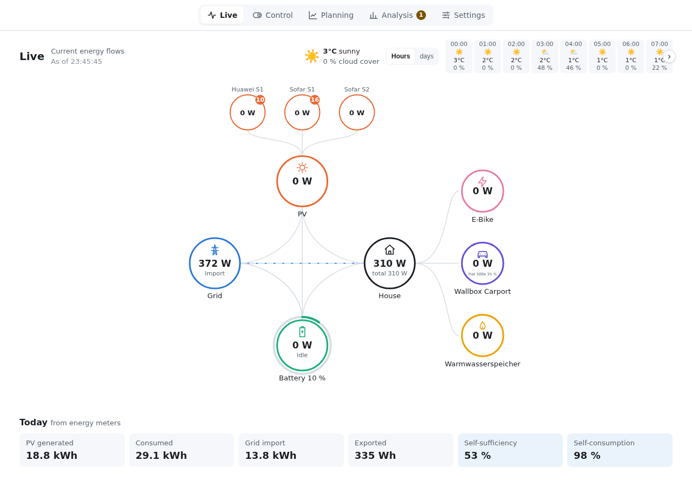

# Sunflow – Documentation

[Deutsch](../README.md) · **English**

Sunflow plans the home battery, EV charging, hot water and other loads ahead of time, based on
the PV forecast and the electricity price, and can carry out the plan itself. It runs as an App
in Home Assistant and uses the integrations you already have there; it needs no device drivers
of its own.

> The interface is available in English and German and follows the language of Home Assistant;
> you can change it under Settings → Display → Language. The screenshots in this documentation
> show the English interface.

## Getting started

1. [Installation and setup](installation.md): install the App, choose integrations, take over
   devices, device test, balance check, tariff and forecast.
2. [User interface](user-interface.md): the Live, Control, Planning and Analysis views.
3. [Handing over control](control.md): when and how Sunflow switches devices itself, safeguards
   and the log.

## Reference

- [Settings](settings.md): every area from "Integrations" to "Summary".
- [How Sunflow plans](planning.md): strategies, costs, wear, aging, learning and grid-friendly
  behaviour.
- [Supported devices](devices.md): which inverters, batteries, meters, wallboxes and loads
  Sunflow knows, what it can do with them and what has been tested on real hardware.
- [Electricity prices](prices.md): dynamic tariffs (Tibber, Nord Pool, aWATTar and others) and
  surcharges on spot prices.
- [Optimizers](optimizers.md): show, assign and arrange module optimizers (Huawei, Tigo) per
  string on the roof.
- [Sunflow integration](integration.md): forecast in the Energy dashboard, entities, actions,
  events and watchdog in Home Assistant.
- [MCP server](mcp.md): Sunflow's data for AI assistants such as Claude Code, read only.
- [Troubleshooting](troubleshooting.md): common questions and what helps when something goes wrong.

## Terms

| Term | Meaning |
|---|---|
| Plan | What Sunflow intends for every quarter hour of the next up to 96 hours: battery, loads, grid |
| Profile | Describes which entities of an integration deliver which values and how the device is controlled |
| Parameters | Values Sunflow cannot measure, e.g. usable capacity or maximum charging power |
| Shadow mode | Sunflow records what it would do and what actually happens, even while it does not control anything |
| Strategy | Goal for the home battery: Balanced, Absorb as much PV as possible, As self-sufficient as possible, or Battery use |
| Expert mode | Switch in the settings; additionally shows entity, unit, factor and sign per role |

The screenshots come from a test installation; your values and device names will differ.
