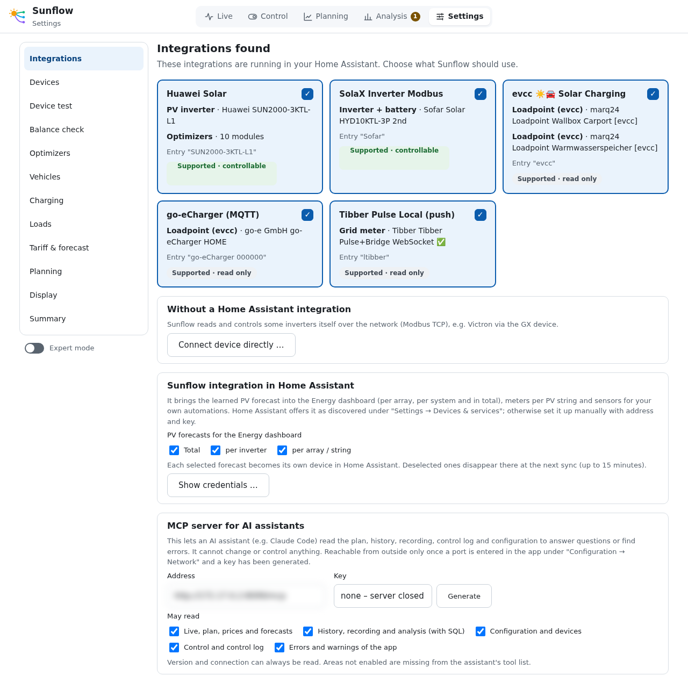
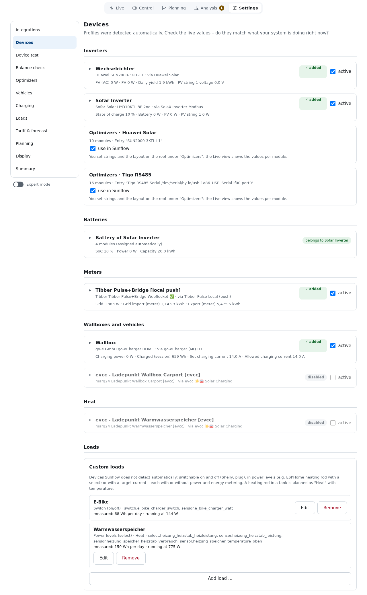
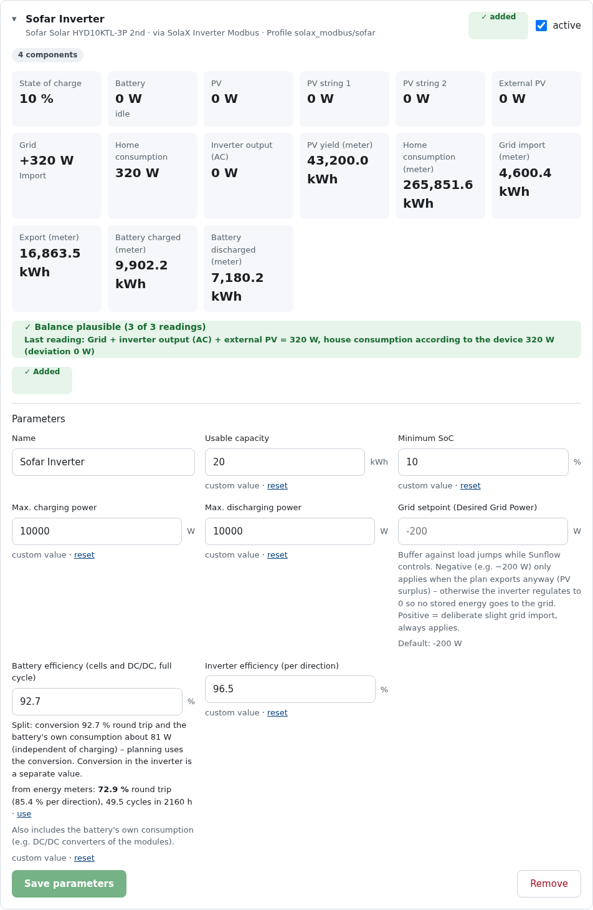
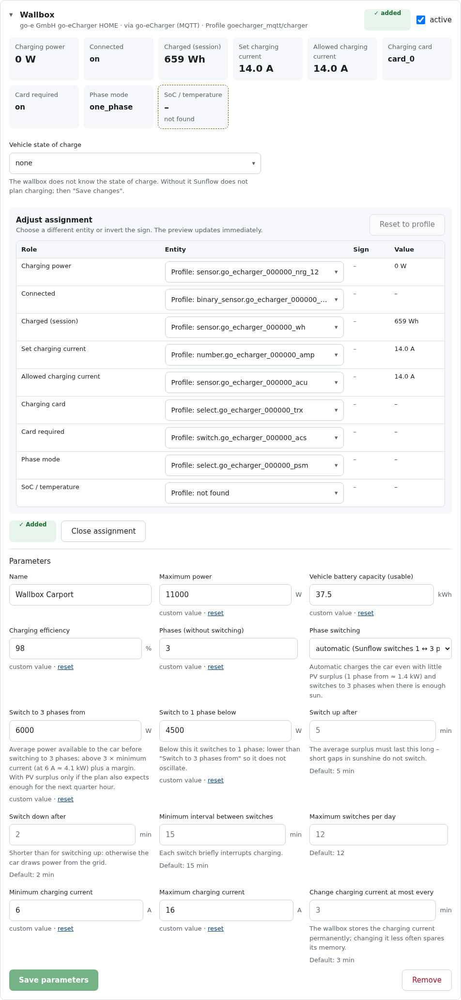
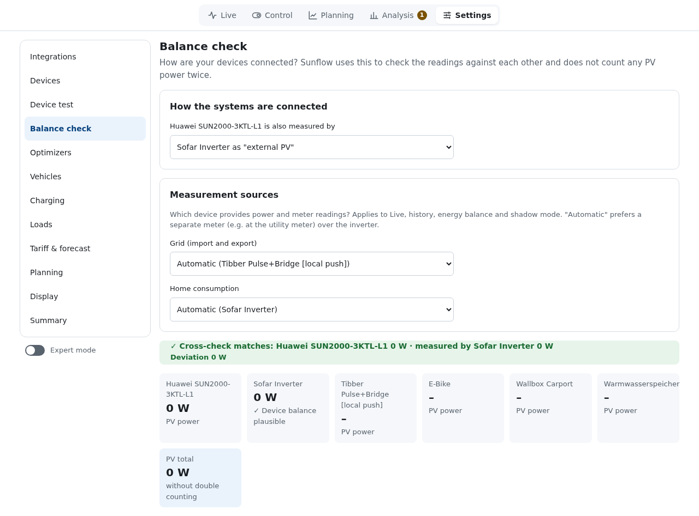
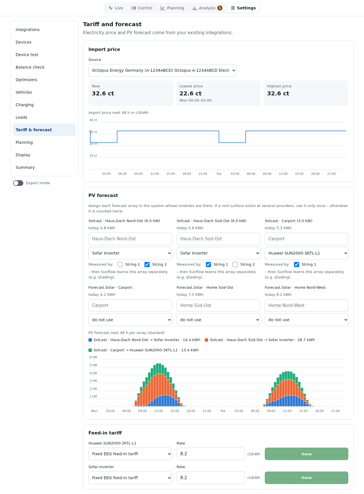
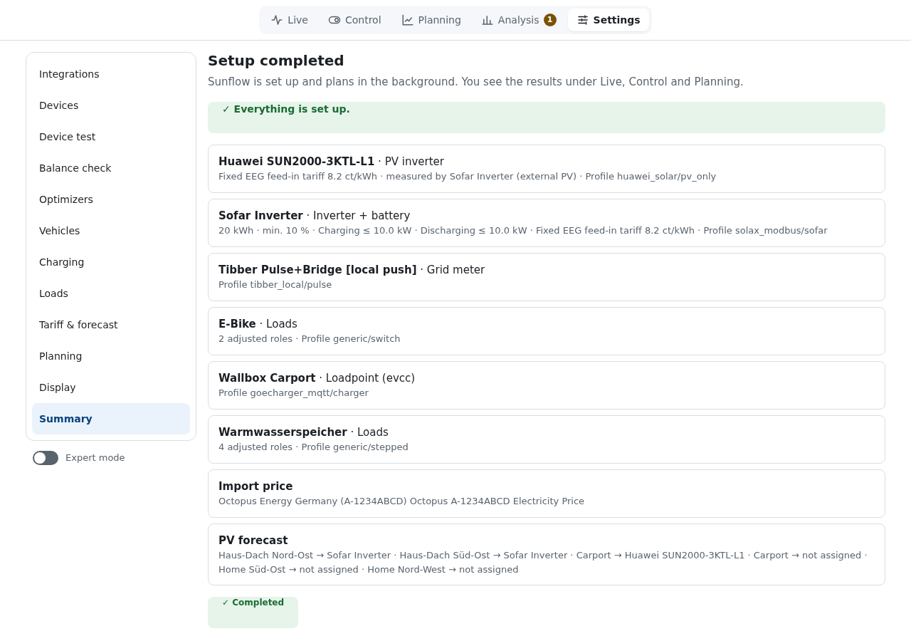

# Installation and setup

[Deutsch](../installation.md) · **English**

## Requirements

- Home Assistant OS or Supervised (for Apps, formerly "add-ons").
- The integrations of your devices are set up in Home Assistant, e.g. `solax_modbus` for the
  inverter, `goecharger_mqtt` for the wallbox, Solcast or Forecast.Solar for the PV forecast and
  an integration for the electricity price. See [Supported devices](devices.md) and
  [Electricity prices](prices.md) for what Sunflow knows.
- Some devices without an integration (e.g. Victron GX) Sunflow connects directly via Modbus TCP.

## Install the App

1. In Home Assistant open **Settings → Apps → App store → ⋮ → Repositories** and add
   `https://github.com/Zwer2k/sunflow`.
2. Install **Sunflow**. The Supervisor builds the App on the device; this takes a few minutes.
3. Start the App and enable "Show in sidebar". Sunflow opens in its panel.

Updates appear like for any other App once a new version is published.

## Setup step by step

On first start Sunflow walks you through the areas of the settings. **Next** moves on;
later you reach every area directly from the sidebar.

Only "no device" blocks the setup. Missing electricity price, PV forecast or feed-in tariff
produce warnings, and Sunflow falls back to substitutes (fixed price, self-consumption only).

### 1. Integrations

Sunflow lists the integrations in your Home Assistant that it knows, with the devices found. Tick
what Sunflow should use. The label tells you what is possible:

- **Supported · controllable**: Sunflow can measure and control.
- **Supported · read only**: Sunflow measures and plans. Control is
  not available for these devices or not tested yet.
- **Supported · optimizers**: provides module optimizers only.

You will also find here:

- **Connect device directly …** for devices without a Home Assistant
  integration (Modbus TCP).
- **Sunflow integration in Home Assistant**: which PV forecasts go to the Energy dashboard, plus
  address and key for manual setup. See [Sunflow integration](integration.md).
- **MCP server for AI assistants**: see [MCP server](mcp.md).

### 2. Devices

For every device of the chosen integrations Sunflow suggests a profile and shows live values.
Check that they match what your system is doing right now, e.g. whether charging is positive and
discharging negative. Then:

- **Values are correct** (or **Add with changes** after you adjusted something) adds the device
  to Sunflow. Its category (inverter, battery, meter, wallbox, heat, load) is stored at the same
  time.

Example: inverter with battery (Sofar)

- **Parameters** add what Sunflow cannot measure: usable capacity, minimum state of
  charge, maximum charge and discharge power, efficiency; for the wallbox phases and currents;
  for hot water volume and daily demand. Fields marked "custom value" override the profile's
  suggestion; "reset" goes back to it.
- **Assign entities** (expert mode) changes entity, unit, factor or sign of
  a role.

Example: wallbox (go-e) with entity assignment and phase switching

- **active** switches a device off without losing its settings, e.g. to switch between
  the evcc loadpoint and the go-e directly.
- **Custom loads**: devices Sunflow does not detect by itself (switch, power
  levels or target current) are added at the bottom of the page.
- **Optimizers**: if a chosen integration has module optimizers, a card with "use in Sunflow"
  appears under the inverters. See [Optimizers](optimizers.md).

### 3. Device test

For every controllable device with a battery a short test checks that commands arrive and that
the signs are right:

1. Measure the initial state for 20 s (read only).
2. If needed, switch the inverter into its control mode (a single flash write).
3. Limit charging or discharging to 300 W, or charge 500 W from the grid, for 60 s.
4. Check that the battery follows in the expected direction.
5. Back to self-consumption and the previous mode, then observe for 30 s.

On abort or error Sunflow resets immediately. Pause automations of other systems that write the
same values first. Only after a passed test can [control](control.md) be enabled for the device.
Pure PV inverters need no test.

### 4. Balance check

Define how the devices are connected. For example, a second inverter may be measured by the first
one as "External PV"; then Sunflow does not count its power twice. Under **Measurement sources**
you choose which device provides grid and house consumption. "Automatic" prefers a separate meter at the electricity meter (e.g. Tibber Pulse) over the inverter.

The cross-check compares the measurements with each other and reports whether the balance adds up.

### 5. Optimizers, vehicles, charging, loads

You only need these areas if you have the devices. They are described under [Settings](settings.md).

### 6. Tariff & forecast

- **Import price**: the sensor of your tariff. Sunflow reads the price curve where
  the integration offers it. For pure spot prices a surcharge and VAT are added. See
  [Electricity prices](prices.md).
- **PV forecast**: assign every forecast plane (Solcast, Forecast.Solar) to the
  inverter its modules are connected to. If the same roof exists at several providers, use it
  only once, otherwise it counts twice. With "Measured by" Sunflow learns a plane
  on its own (e.g. shading in the morning).
- **Feed-in tariff**: per inverter, fixed (EEG) or dynamic (direct marketing).

### 7. Planning and display

Battery strategy, charge limit, backup reserve, wear costs and more: see
[Settings → Planning](settings.md#planning) and [How Sunflow plans](planning.md).

### 8. Summary

The summary lists all devices, the tariff and the forecast, and shows whether anything is missing.
**Complete setup** completes the setup. From now on Sunflow plans in the
background but does not control anything yet; you enable that under [Control](control.md) once
the plan looks right to you.

## Moving data

Under **Analysis → Shadow mode**, "Export data" downloads a ZIP file with the recording,
configuration, control log and current plan. "Import export" merges the recording into another installation; the configuration is not imported. Keys
(integration, MCP) are never part of the export.
