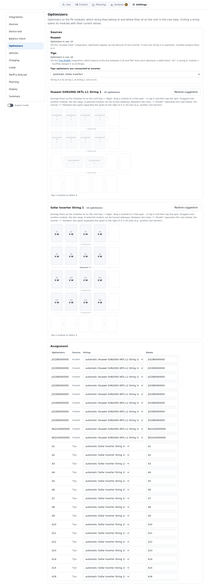
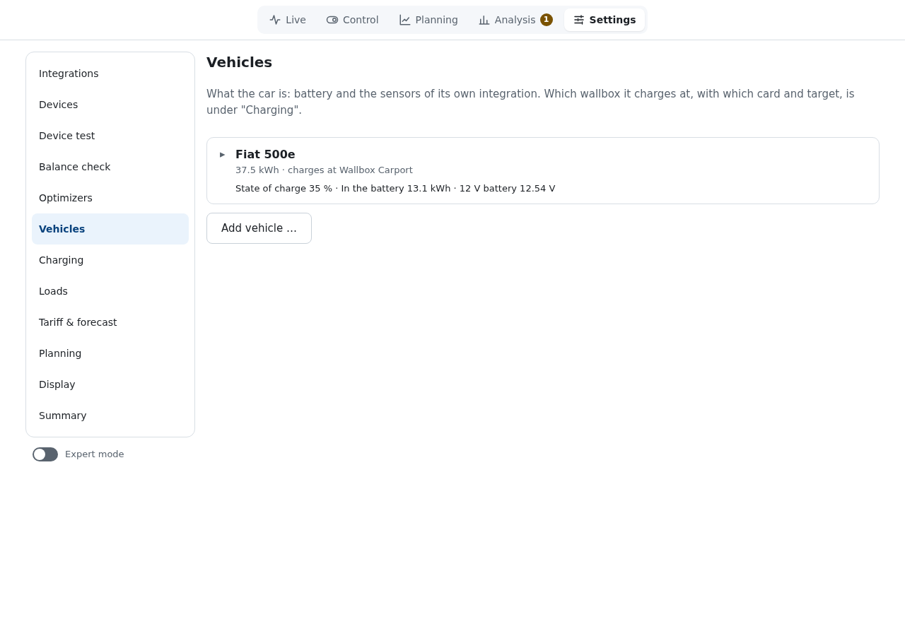
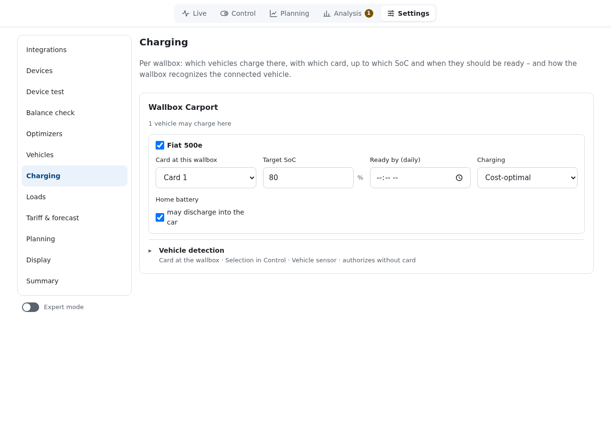
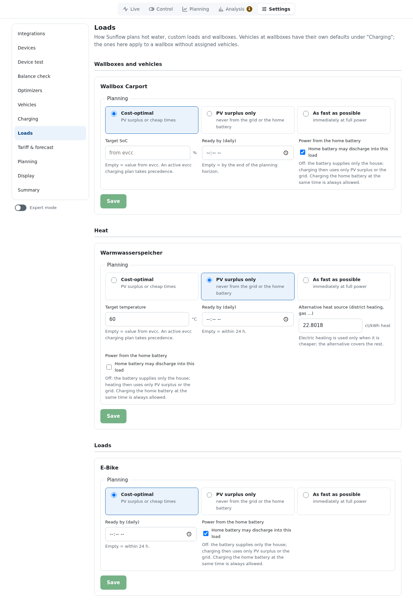
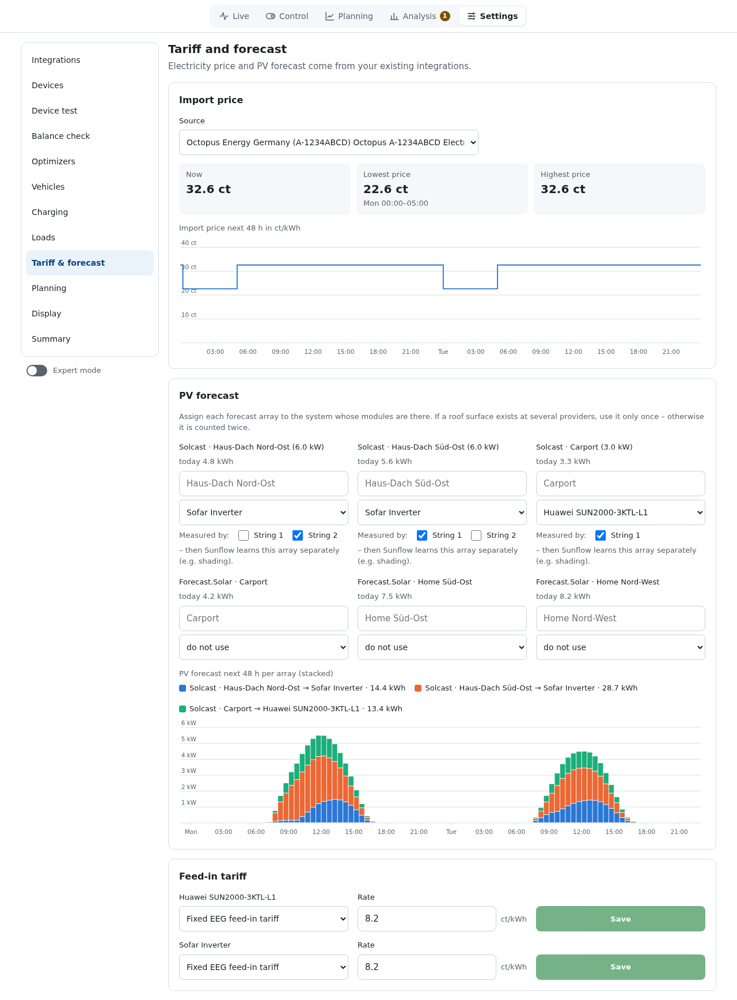
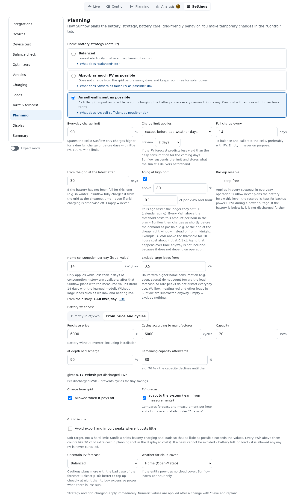
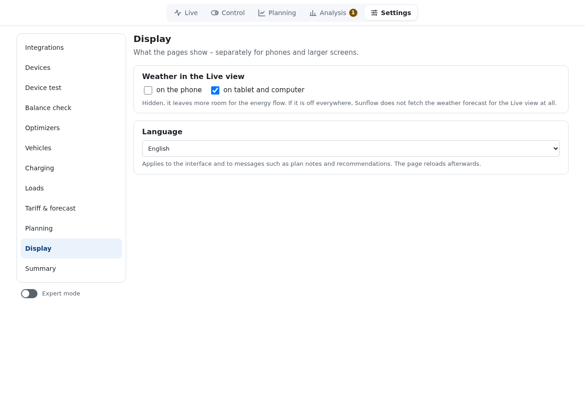

# Settings

[Deutsch](../einstellungen.md) · **English**

The settings are split into areas; on first start Sunflow walks through them in order (see
[Installation and setup](installation.md)). Unsaved changes in one area are kept when you switch
to another.

**Expert mode** (switch below the list) additionally shows entity, unit, factor,
sign, decimals, polling interval and RAM/flash per role. These values are stored as deviations
from the profile. The browser remembers the switch.

## Integrations, devices, device test, balance check

Described in [Installation and setup](installation.md).

## Optimizers

Sources, arrangement on the roof and assignment of module optimizers: see [Optimizers](optimizers.md).

## Vehicles

What the car is, independent of the wallbox:

- **Name**, **Battery capacity (usable)** and **Charging efficiency**.
- **State of charge**: the sensor from the car's integration.
- **Plugged in / home** (optional, e.g. a `device_tracker`): Sunflow
  learns when the car usually comes home and leaves, and plans it as soon as it is at home.
  Without it, the plug-in times at the wallbox are used.
- **Maximum charging power single-phase** and **three-phase** (optional, e.g. Fiat 500e:
  7.4 kW / 11 kW). Sunflow never asks the wallbox for more current than the car takes, and plans
  with this power.
- **Protect 12 V battery**: with the car's voltage sensor the wallbox
  charges briefly at minimum current when the auxiliary battery drops below the limit (default
  12.2 V, charge for 5 min, then at least 60 min pause). Details in [Supported devices](devices.md).

From the state-of-charge history of the last four weeks Sunflow learns how much the car uses per
hour (weekdays and weekends separately, from 14 days of data).

## Charging

Per wallbox:

- **Which vehicles** may charge here.
- **Card at this wallbox**: the RFID card that identifies the vehicle.
- **Target SoC** and **Ready by (daily)**.
- **Charging**: Cost-optimal, PV surplus only or As fast as possible.
- **Home battery** "may discharge into the car": when off,
  the car charges from PV surplus or the grid only.
- **Vehicle detection**: in which order Sunflow detects the plugged-in
  car (card at the wallbox, selection under Control, the vehicle's sensor) and whether the wallbox
  releases charging without a card.

## Loads

Defaults for wallboxes without assigned vehicles, hot water and own loads:

- **Planning**: Cost-optimal (PV surplus or cheap hours), PV surplus only (never from the grid
  or the home battery) or As fast as possible (now at full power).
- **Target**: state of charge or temperature; empty takes the value from evcc. An active
  evcc charging plan takes precedence.
- **Ready by (daily)**: empty means by the end of the plan, or within 24 h.
- **Power from the home battery**: whether the battery may discharge
  into this load.
- **Alternative heat source (district heating, gas …)** (hot water): price per kWh of heat from
  district heating, gas or similar. Sunflow only heats electrically when that is cheaper.

Sunflow learns when and how much hot water is used (per hour, weekdays and weekends separately,
from one week of data) and, without a set ready time, heats up before the usual main usage time.
If the tank regularly warms up without its own heating rod (district heating, gas), Sunflow learns
the temperature at which that heat source starts; the temperature forecast does not fall below it.

## Tariff & forecast

Import price, PV forecast per plane and feed-in tariff per inverter. See
[Installation and setup](installation.md#6-tariff--forecast) and
[Electricity prices](prices.md).

## Planning

How Sunflow plans the home battery. Background in [How Sunflow plans](planning.md).

| Setting | Meaning |
|---|---|
| Home battery strategy (default) | Balanced, Absorb as much PV as possible or As self-sufficient as possible. "What does … do?" expands the explanation. |
| Everyday charge limit | Sunflow only charges above it for a due full charge. 100 % = no limit. |
| Full charge every … days | To balance and calibrate the cells, preferably with PV. Empty = never on purpose. |
| From the grid at the latest after … days | If the battery has not been full for that long (e.g. in winter), Sunflow fills it from the grid at the cheapest time. |
| Aging at high SoC | Every kWh above the threshold (default 80 %) costs a small amount per hour (default 0.1 ct). Sunflow then charges as late as possible before the demand. Can be switched off. |
| Backup reserve | Applies in every strategy: in everyday use Sunflow never plans the battery below this level. |
| Home consumption per day (initial value) | Used while less than 7 days of history exist. |
| Exclude large loads from | Hours with higher house consumption (e.g. oven, sauna) are left out of the load forecast. Controllable loads are subtracted anyway. |
| Battery wear cost | Directly in ct/kWh, or calculated from purchase price, cycles, depth of discharge and remaining capacity. Prevents cycling for tiny gains. |
| Charge from grid | "allowed when it pays off". |
| PV forecast | "adapt to the system (learn from measurements)": learns from measurements per hour and cloud cover; details under Analysis. |
| Grid-friendly | Avoid export and import peaks above the set limits where it costs little. A soft goal, not a hard limit. |
| Uncertain PV forecast | "Cautious" plans more with the bad case of the forecast (Solcast p10). |
| Weather for cloud cover | Weather entity used for learning per cloud cover. |

Strategy and grid charging apply immediately. Numbers are applied with **Save and replan**.

## Display

- **Weather in the Live view**: can be hidden separately for phones and for tablets/computers. If
  it is off everywhere, Sunflow does not fetch the weather forecast for it.
- **Language**: "Same as Home Assistant" (default: German if Home Assistant is set to German, English
  otherwise), "Deutsch" or "English". Applies to the interface and to messages such as plan notices
  and recommendations. The page reloads afterwards.

## Summary

Lists devices, tariff and forecast and marks what is still missing (see
[Installation and setup](installation.md#8-summary)).
