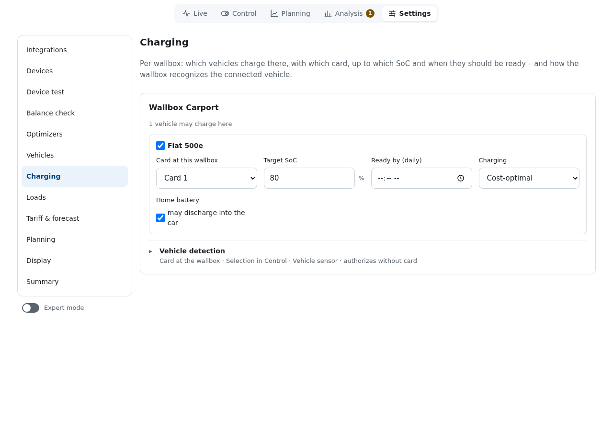
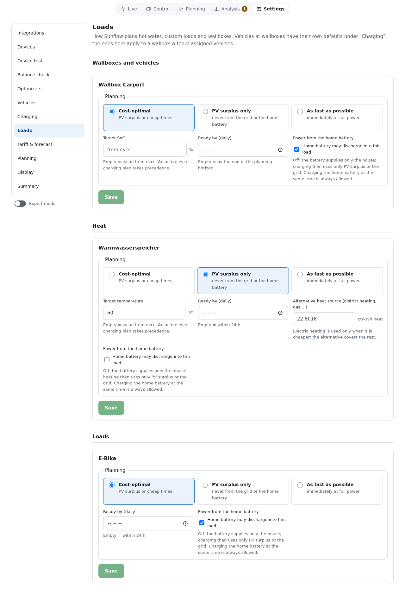

# Settings

[Deutsch](../einstellungen.md) · **English**

The settings are split into areas; on first start Sunflow walks through them in order (see
[Installation and setup](installation.md)). Unsaved changes in one area are kept when you switch
to another.

**Search** (box above the list) finds a setting by its name, by other words for it ("battery",
"backup", "Tibber", "export limit"), despite typos, and your devices by name. A result opens the
area, scrolls to the setting and highlights it briefly. Arrow keys and Enter choose, Esc clears
the box.

**Expert mode** (switch below the list) additionally shows entity, unit, factor,
sign, decimals, polling interval and RAM/flash per role. These values are stored as deviations
from the profile. The browser remembers the switch.

## Integrations, devices, device test, balance check

Described in [Installation and setup](installation.md).

## Optimizers

Sources, arrangement on the roof and assignment of module optimizers: see [Optimizers](optimizers.md).

## Vehicles

What the car is, independent of the wallbox:

- **Name**, **Battery capacity (usable)** and **Charging efficiency**.
- **State of charge**: the sensor from the car's integration. **Estimate between reports** (on by
  default): many cars send their state of charge only now and then, e.g. a Fiat 500e through its
  cloud. In between, Sunflow adds what the wallbox charged into this car since. With every new
  report it compares the estimate with the real value and learns how much of the wallbox's energy
  reaches the battery (first the charging efficiency, then learned, over roughly the last 60 kWh).
  It only learns from reports after at least 1.5 kWh, not at 100 % and not when the car was driven
  in between. Estimated values show with "≈"; the vehicle's card shows the last report, what was
  charged since and what was learned.
- **Plugged in / home** (optional, e.g. a `device_tracker`): Sunflow
  learns when the car usually comes home and leaves, and plans it as soon as it is at home.
  Without it, the plug-in times at the wallbox are used.
- **Maximum charging power single-phase** and **three-phase** (optional, e.g. Fiat 500e:
  7.4 kW / 11 kW). Sunflow never asks the wallbox for more current than the car takes, and plans
  with this power.
- **Protect 12 V battery**: with the car's voltage sensor the wallbox
  charges briefly at minimum current when the auxiliary battery drops below the limit (default
  12.2 V, charge for 5 min, then at least 60 min pause). Details in [Supported devices](devices.md).

From the state-of-charge history of the last four weeks Sunflow learns how much the car uses per
hour (weekdays and weekends separately, from 14 days of data).

## Charging

Per wallbox:

- **Which vehicles** may charge here.
- Per vehicle **Target SoC**, **Ready by (daily)**, **Charging** (Cost-optimal, PV surplus only or
  As fast as possible) and whether the **home battery may discharge into the car** (when off, the
  car charges from PV surplus or the grid only). These apply when the car is recognized without a
  card (sensor, selection under Control, the only vehicle).
- **Cards** (wallboxes with RFID): a vehicle can have several cards, each with its own number,
  name and values as above. When a card is scanned its values apply, e.g. a card "Holiday" with
  100 % by 7:00 and a card "Everyday" with 80 %. Its name is shown wherever "Card 3" would be. A
  number belongs to at most one card at a wallbox. When Sunflow recognizes the car without a card
  and releases the wallbox, it uses the vehicle's first card for that.
- **Vehicle detection**: in which order Sunflow detects the plugged-in
  car (card at the wallbox, selection under Control, the vehicle's sensor) and whether the wallbox
  releases charging without a card.

## Heat pump

Measuring and controlling the heat pump (SG-Ready with two relays, contact 2 only or a select,
setpoint, reported PV surplus, boost switch) with the rules for when it is boosted or blocked; also
the heat pump's heating rod with its mode per season and how the heating season is detected. Live values show power, heat,
COP and the state Sunflow sets or (in shadow mode) would set. Details under
[Supported devices](devices.md#heat-pump).

**House:** room temperatures (one or more sensors, optionally weighted, e.g. by area, one as the
reference room), optionally the heat into the house (e.g. the heating's heat meter, otherwise the
heat pump's heat) and the comfort band with an optional night setback. From the hourly values of
the last four weeks Sunflow learns a simple thermal model of the house:

| Learned | Meaning |
|---|---|
| Time constant | hours until two thirds of the difference to outside are gone |
| Cooling at 0 °C outside | kelvin per hour lost without heating and sun |
| Heat loss | heating power per kelvin of difference (only with heat measurement) |
| Heat storage | heat for 1 K warmer in the whole house (only with heat measurement) |
| Sun | warming in full sun (with brightness under learning sources) |

Sunflow holds back the last two days and computes them anew from the measurement each day; the
model is used only when it beats "the temperature stays the same" there and its values are
plausible (from 7 days). A chart shows the last week measured and expected by the model. Rooms whose
temperature jumps far more than the others' (sun, radiator, window at the sensor) are named.

Once the model is reliable it safeguards the heat pump's rules: in the heating season Sunflow
**blocks** it only if the reference room's predicted temperature without heating stays above the
lower bound until the block ends (the night setback applies at night); if the house cools faster, a
running block ends at once. **Boosting** ends at the upper bound in the heating season; in summer the
heat pump heats hot water and the rooms do not count.

**Plan preheating (test):** switched on at the heat pump under control, with its maximum electric
power. Sunflow then plans the heat pump in the optimizer together with the battery and loads; the
room temperature is a heat storage there. It preheats in sunny or cheap hours and lets the house cool
in dear ones, always within the comfort band (below it is very expensive, above it slightly). The COP
follows the outside temperature of the weather forecast. What the heat pump would draw unplanned is
taken out of the load forecast and added back for the comparison "without Sunflow". Planned power
well above that draw boosts ("preheating as planned"), well below it blocks ("pause as planned"),
with all block limits and the check above; this replaces the cheapest and dearest hours. Only in
the heating season and once the house model is reliable and knows the heating's heat. The section
"House" shows the planned room temperature of the next 48 hours.

## Loads

Defaults for wallboxes without assigned vehicles, hot water and own loads:

- **Planning**: Cost-optimal (PV surplus or cheap hours), PV surplus only (never from the grid
  or the home battery) or As fast as possible (now at full power).
- **Target**: state of charge or temperature; empty takes the value from evcc. An active
  evcc charging plan takes precedence.
- **Highest target by hand**: the target can be chosen up to this value in Control and Live,
  also with the knob; Sunflow rejects higher values. Empty: 60 °C for hot water (above it there
  is a risk of scalding at the tap), 100 % for a car.
- **Ready by (daily)**: empty means by the end of the plan, or within 24 h.
- **Power from the home battery**: whether the battery may discharge
  into this load.
- **Alternative heat source (district heating, gas …)** (hot water): price per kWh of heat from
  district heating, gas or similar. Sunflow only heats electrically when that is cheaper.

Sunflow learns when and how much hot water is used (per hour, weekdays and weekends separately,
from one week of data) and, without a set ready time, heats up before the usual main usage time.
If the tank regularly warms up without its own heating rod (district heating, gas), Sunflow learns
the temperature at which that heat source starts; the temperature forecast does not fall below it.

## Tariff & forecast

Import price, PV forecast per plane and feed-in tariff per inverter. See
[Installation and setup](installation.md#6-tariff--forecast) and
[Electricity prices](prices.md).

## Planning

How Sunflow plans the home battery. Background in [How Sunflow plans](planning.md).

| Setting | Meaning |
|---|---|
| Home battery strategy (default) | Balanced, Absorb as much PV as possible, As self-sufficient as possible or Battery use. "What does … do?" expands the explanation. |
| Everyday charge limit | Sunflow only charges above it for a due full charge. 100 % = no limit. |
| Charge limit applies | "always" or "except before bad-weather days": if the preview (tomorrow up to 5 days) has a day with less PV than consumption, the battery may become full to store the PV before it. |
| Full charge every … days | To balance and calibrate the cells, preferably with PV. Empty = never on purpose. |
| From the grid at the latest after … days | If the battery has not been full for that long (e.g. in winter), Sunflow fills it from the grid at the cheapest time. |
| Aging at high SoC | Every kWh above the threshold (default 80 %) costs a small amount per hour (default 0.1 ct). Sunflow then charges as late as possible before the demand. Can be switched off. |
| Backup reserve | Applies in every strategy: in everyday use Sunflow never plans the battery below this level. If it is below, Sunflow refills it first, from the grid if allowed, whatever the price. **Go below it on a safe forecast**: during the day's PV phase down to the lowest level, as far as the pessimistic PV forecast (p10) surely brings the battery back to the reserve on the same day (e.g. large loads in the morning without grid import right away). Consumption counts 25 % above the forecast; the lowest level defaults to 10 %. |
| Home consumption per day (initial value) | Used while less than 7 days of history exist. |
| Exclude large loads from | Hours with higher house consumption (e.g. oven, sauna) are left out of the load forecast. Controllable loads are subtracted anyway. |
| Battery short name | Per battery under Devices → Battery, up to 8 characters; shown with several batteries in Live and Plan. Without one: the first word of the name. |
| Battery wear cost | Per battery under Devices → Battery: directly in ct/kWh, or calculated from purchase price, cycles, depth of discharge and remaining capacity; plus the switch "Include in planning". Prevents cycling for tiny gains. |
| Charge from grid | "allowed when it pays off". |
| PV forecast | "adapt to the system (learn from measurements)": learns from measurements per hour and cloud cover; details under Analysis. |
| Correct by sun position (test) | For planes with Solcast history: a correction per sun elevation and direction, learned from up to two years (once a day); recognises shading that moves with the seasons. Replaces the correction by time of day for planes whose model was learned from at least 60 days and is better in the backtest. Backtest and shading map under Analysis. |
| Grid-friendly | Avoid export and import peaks above the set limits where it costs little. A soft goal, not a hard limit. |
| Uncertain PV forecast | "Cautious" plans more with the bad case of the forecast (Solcast p10). |
| Weather for cloud cover | Weather entity used for learning per cloud cover. |

All changes apply immediately, numbers once you leave the field or press Enter. Sunflow then replans; "Saved" confirms it briefly.

**Learning sources** (optional): additional sensors make the learned forecasts more precise. None
is required. Sunflow suggests sensors by their device class or unit; the inverter's and battery's
own temperatures are left out. Below each choice you see how far back Home Assistant keeps its
values. Sensors without a `state_class` have no long-term statistics, only the recorder history.

Each chosen source is checked for plausibility (up to 100 days). Learning leaves out values outside
the physically possible range, short spikes away from the neighbouring values and values that stay
the same implausibly long (a hanging sensor); outages up to 30 minutes are bridged, longer ones stay
gaps. Times Home Assistant itself did not record (recognised by the grid power) do not count, nor, for
optimizers, the time with the sun below 5° (they sleep without light). The
plausible share is shown below the choice and highlighted below 80 %. Nothing changes in Home
Assistant.

| Source | Used for |
|---|---|
| Outdoor temperature | Measured in the shade; heating share of the house consumption and module temperature. Without it: the weather entity's temperature. |
| Outdoor humidity | With the temperature: dew and frost on the modules. |
| Illuminance or irradiance | How bright it really was (lx or W/m²); tells clouds from shading, also retroactively. |
| Precipitation | Detecting snow on the modules. |
| Module temperature per roof plane | Warm modules yield less. If the plane has optimizers (assigned through its strings) and nothing is chosen, Sunflow takes the mean of their temperatures; otherwise estimated from outdoor temperature and irradiance. |

## Display

- **Weather in the Live view**: can be hidden separately for phones and for tablets/computers. If
  it is off everywhere, Sunflow does not fetch the weather forecast for it.
- **Language**: "Same as Home Assistant" (default: German if Home Assistant is set to German, English
  otherwise), "Deutsch" or "English". Applies to the interface and to messages such as plan notices
  and recommendations. The page reloads afterwards.

## Summary

Lists devices, tariff and forecast and marks what is still missing (see
[Installation and setup](installation.md#8-summary)).
