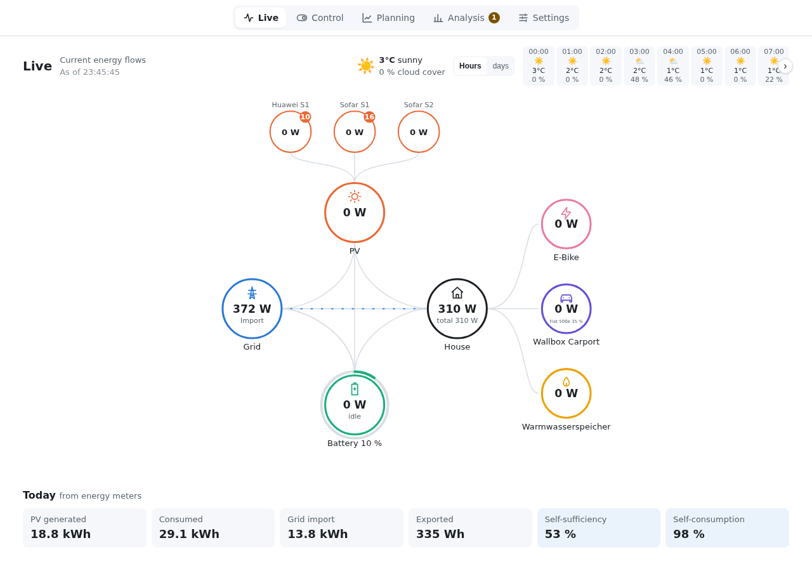
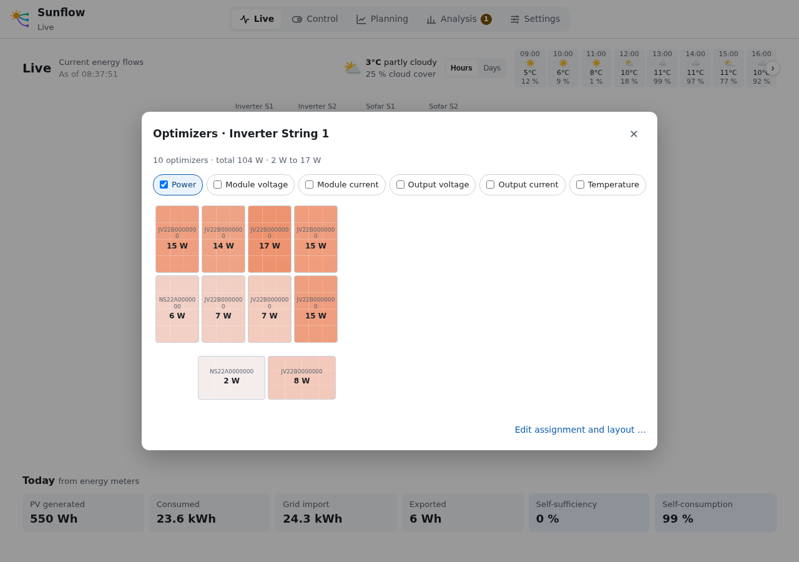
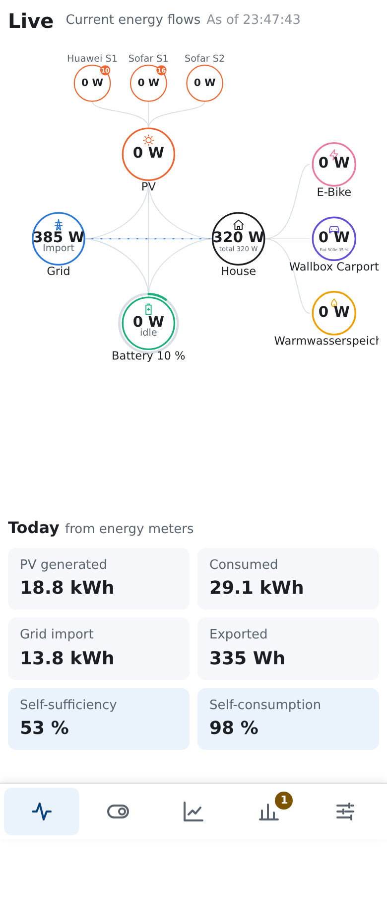
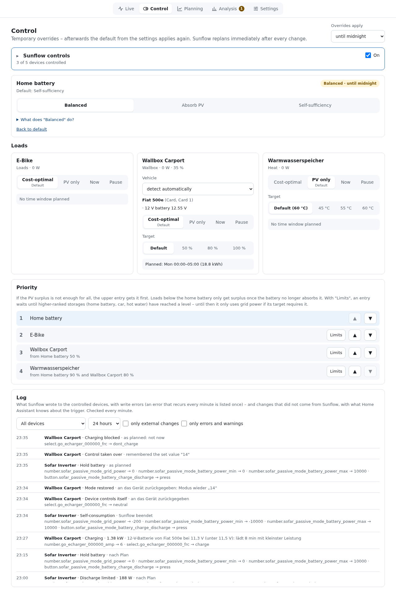
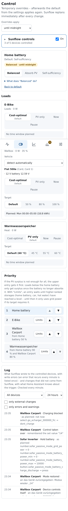
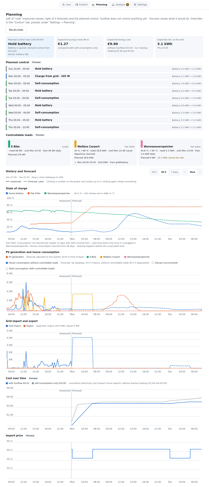
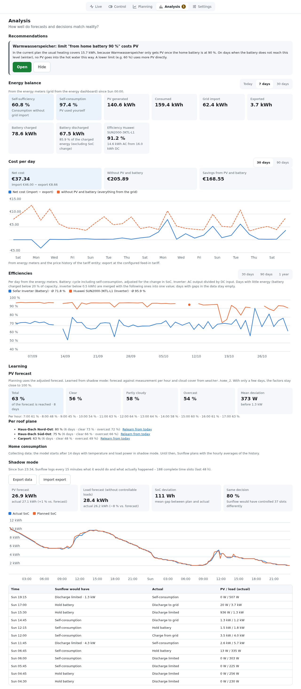

# User interface

[Deutsch](../bedienung.md) · **English**

The top bar switches between the five views: **Live**, **Control**, **Planning**, **Analysis**
and **Settings**. On phones they are icons at the bottom. A number on "Analysis" shows open
recommendations.

At the far right of the menu bar two switches hide in every view what you no longer need; each
browser remembers its choice, both start switched on:

- **?** – explanations (descriptions below headings and fields, "What does … do?").
- **Light bulb** – recommendations under "Analysis" and their number on "Analysis".

## Live

The energy flow shows what is flowing right now: PV (top, with one circle per string), grid,
home battery, house and the controllable loads such as wallbox and hot water. Animated lines show
where energy is going.

Below the energy flow on the right you choose the view; each browser remembers its own. On a phone
this is one button with the current view's symbol that opens the choice. On a phone this line, the
quick controls and today's figures stay at the bottom above the menu bar while scrolling, as long
as they take at most 60 % of the screen:

- **Diagram**: the large graphic with strings and animated lines.
- **Bars**: two flat bars, "From" (PV, battery, grid import) and "To" (house, loads, battery,
  export), each across the full width with the values below; the battery's state of charge and
  whether it charges are in the line below. Fits next to the quick controls.
- **Tiles**: one small tile per component and load with power, state and level; also shows more
  than four loads.
- **House**: the site as an animated picture – sun (brighter and faster with more PV) or moon and
  stars, clouds from the weather, panels on the roof, grid pole, battery with its level, hot water
  tank in its temperature colour, carport with wallbox and car. Glowing flows run from the inverter
  to each part, thicker and faster with more power. "Reduce motion" in the system stops the motion.
- **3D**: the site as a spatial drawing with callouts like a brochure. Up to four roof faces (house
  roof south, the north side hinted behind the ridge, annex, carport), up to two inverters with up
  to two batteries each below them, grid connection, up to two cars with their wallbox under the
  carport. Strings go onto the roof by
  their forecast plane: a plane named e.g. "North…" or "Carport" lands there, the others in order.
  E-bike (in the back north corner), heat pump, hot water tank, washing machine, dryer and stove only appear when set up as
  loads with a power measurement (recognized by name); the appliances in the house show through
  the big window.

- **House** shows consumption without the controllable loads; "total" below includes them.
- **Battery** shows power, direction and state of charge; the ring is the state of charge.
- **Wallbox** shows charging power and the state of charge of the detected car.
- **PV strings**: the number at the circle is the number of optimizers. A click opens the module
  optimizers of the string with their current values (see [Optimizers](optimizers.md)).

  

Example: optimizers of a Huawei string

  

  

- **Weather**: current conditions and forecast, switchable between **Hours** and **Days**;
  swipe or use the arrows. It can be hidden under [Settings → Display](settings.md#display).
- **Quick controls** (on a PC to the right of the energy flow, which takes 60 % of the width on the left; on a phone below it): one row per load you pinned under Control, with
  power, state of charge and next charging window, and the modes as small buttons: € Cost-optimal,
  PV PV only, ⚡ Now, ⏸ Pause. On a phone one button shows the current mode and opens the choice,
  so the name keeps its line. A change applies until midnight. For "Charge battery" without a plug
  sensor, 🔌 switches "plugged in now". At the wallbox a button with a car symbol shows the choice – "detect" or the chosen vehicle – and
  opens the list; 🎯 shows the target (state of charge or
  temperature) and opens a knob for any value up to the
  [highest target by hand](settings.md#loads), "Default" (with its value) undoes the change. Without pinned loads
  the block is not shown.
- **Today** sums up the energy meters: PV generated, consumed, grid import, exported,
  inverter/battery losses, self-sufficiency and self-consumption.
- **Inverter/battery losses** (below the energy flow, average of the last minutes): the balance
  of PV, grid and battery minus the measured house consumption, i.e. conversion losses and the
  devices' own consumption. Home Assistant's energy dashboard counts them as house consumption,
  so it shows more consumption and more self-sufficiency than Sunflow. Only with a consumption
  counter or measurement.

## Control

Temporary overrides of the plan; afterwards the defaults from the settings apply again.
**Overrides apply** sets for how long: until midnight, 4 hours or until
further notice. Sunflow replans immediately after every change.

- **Sunflow controls**: main switch and one switch per device, with each
  device's state. Collapsed, it shows how many devices are controlled and whether one has a
  problem. Details in [Handing over control](control.md).
- **Home battery**: strategy for the period (Balanced, Absorb PV, Self-sufficiency, Battery use;
  short on a phone: Balanced, PV, Self-suff., Battery).
  "What does … do?" expands the explanation of the strategy.
- **Loads**: per wallbox, hot water tank or own load the mode (Cost-optimal, PV only, Now,
  Pause) and the target (state of charge or
  temperature): default, a preset or any value via "±" with the knob (drag, mouse wheel,
  arrow keys or −/+, then "Apply"). For the wallbox you choose the vehicle or let it be detected; the scanned card is
  shown in brackets, e.g. "Fiat 500e (Card 1)". With a sensor set up you also see the voltage of
  the car's 12 V battery. Below it says what the plan intends, or why nothing is planned.
  The **pin** at the top right puts the load's modes on Live as quick controls; for all browsers
  and devices.
- **Priority**: if PV surplus is not enough for everyone, the top entry gets it
  first. With **Limits** a load waits until storages ranked higher reach a level,
  e.g. hot water only above 90 % home battery. Until then it gets no PV or battery power, only grid
  power where the plan provides it. Control checks the limits at every step against the measured
  values, not only the forecast. Limits go in 1 % steps. A limit on the home battery above its
  charge limit (e.g. 100 % at 98 %) counts as met once it reaches the charge limit – otherwise it
  would hardly ever be met. A car only holds back while plugged in, not on the way or only
  expected. A car plugged in but not recognized yet (level unknown) holds waiting loads back.
- **Log**: what Sunflow wrote to devices, with reason and errors, and changes made by
  others with their trigger. Filters by device, period, "only external changes" and "only errors
  and warnings".

## Planning

Left of "now" are measured values, right of it forecast and plan.

- **Header**: planned action now (and what actually happens), expected savings compared to plain
  self-consumption – split into electricity, backup heating (if set) and the value of what is left
  in the battery beyond self-consumption at the end of the plan –, expected electricity cost and
  expected state of charge at the end of the plan. **Recalculate** replans immediately.
- **Notices** in yellow, e.g. when a PV forecast does not reach as far as the plan.
- **Planned control**: the sections of the plan with their action
  (self-consumption, hold battery, charge from grid, limited discharge …) and state of charge
  from → to.
- **Controllable loads**: target, deadline and what is planned per load,
  or why not.
- **History and forecast**: charts for state of charge, PV production and
  house consumption, grid import and export, cost over time and import price.
  - Period 24 h, 48 h or 7 days; page with ‹ ›, **Now** jumps back.
  - Dragging sideways with mouse or finger moves all charts together.
  - Clicking a number on the power axis zooms to it; clicking again shows everything.
  - Clicking an entry in the legend of the state-of-charge chart shows only that one in its unit
    (kWh or °C) with its target.
  - Dashed lines are forecast or plan, solid lines are measured. Estimated prices beyond the
    published ones are dashed as well.
  - Checkboxes show the uncorrected forecast of the source (Solcast, Forecast.Solar) and total
    consumption including controllable loads.

## Analysis

How well do forecasts and decisions match reality?

- **Recommendations**: hints where a setting does not fit the measurements, e.g.
  a hot water demand set too high, or a measured battery efficiency. **Open** goes to the
  setting, **Hide** hides the hint.
- **Energy balance**: self-sufficiency, self-consumption, PV, consumption, grid,
  battery and efficiency for today, 7 or 30 days, from the devices' energy meters.
- **Cost per day**: net cost (import minus export) compared to "without PV and
  battery", and the savings, over 30 or 90 days.
- **Plan a battery**: works out with your measured grid and battery values and the price history
  of the last 30 days, 90 days or a year what a battery would have saved. Per scenario you enter
  capacity, usable share, charge and discharge power, battery and inverter efficiency, purchase
  price and cycles (giving the wear) and whether it works **in addition** to the existing battery
  or **instead** of it. **Use the existing battery** adds your battery with its values, so you can
  work out other settings (grid charging, wear, power) in hindsight. Each scenario is calculated
  as plain self-consumption without control and run as Sunflow does with the strategies you pick
  above the table (Balanced, Absorb PV, Self-sufficiency, Battery use; each browser remembers the
  choice). The strategies know prices and consumption in advance – an upper bound no planning
  reaches. Wear is not part of the electricity cost; a strategy with more cycles per year wears
  the battery more. The table shows import, export, electricity cost, saving
  against today, scaled to a year (without seasons), cycles per year and, with a price, the
  payback. With an existing battery, **No battery** at the top is the house without any battery;
  the column "vs. no battery per year" shows what your battery today and each scenario save
  against none – a negative value means the losses cost more than the battery brings. With a
  purchase price entered for your battery's wear, "Measured" shows its payback against no battery. With hourly
  values the saving is a little too high, as import and export within an
  hour net out. Sunflow controls nothing here.
- **Efficiencies**: battery and inverter over 30 days, 90 days or a year.
- **Learning**: how much of the PV forecast actually arrives (overall, per cloud cover,
  per hour, per plane) and how far the house consumption model is. Per roof plane, "Relearn from
  today" resets learning, e.g. after trimming a tree. Sunflow notices snow, leaves and cleaning itself
  against the other planes and shows it at the plane (see [Planning](planning.md#learning)).
- **PV per plane**: per roof plane the measured strings against Solcast's raw forecast, hourly over
  the last 3, 7 or 14 days, and to the right the raw forecast with its range (p10 to p90) and what
  Sunflow expects from what it learned. Above it the share: how much of the raw forecast was
  measured and how much Sunflow expects for the next days. Depending on the
  [PV risk](settings.md#planning) planning is a little more cautious still.
- **PV by sun position (test)**: learns per roof plane from Solcast's past forecasts and the measured
  strings how much of the forecast arrives per sun elevation and direction, separately for clear
  and cloudy hours. It also learns how far towards p10 the measurement lies when the forecast is
  uncertain (p10 far below the mean, e.g. with low stratus); planning uses this only where it is
  better in the backtest. The shading map shows orange where less arrives (shade), blue where more. The
  backtest learns without the last 3 weeks and compares the deviation per hour on them with the raw
  forecast and the correction by time of day. Planning uses it only once switched on under
  Settings → Planning, and only for planes with at least 60 days and a better backtest.
  If a plane delivers far less than usual at this sun position for several days in a row (without
  a history of its own: less than half of the forecast), a hint points to leaves, snow or dirt;
  Sunflow does not learn from these days. If a plane with a model delivered less than 90 % of the
  learned yield in the last days (e.g. autumn leaves), Sunflow plans with this lower yield and goes
  back by itself as soon as it delivers more (checked every 3 hours). "Relearn from today" also
  drops the history by sun position, so use it after trimming a tree or replacing modules, not
  after cleaning.
- **Data for learning**: how far back Home Assistant keeps what Sunflow can learn from: history at
  full resolution (the recorder's retention), long-term statistics, weather with or without cloud
  coverage, and Solcast's past forecasts. Below, per measurement, since when it is there and how
  often it changes, also per optimizer (power and temperature per module). Checked at most hourly; **Check again** asks right away.
- **Shadow mode**: every 15 minutes Sunflow records what it would do and what
  actually happened. The tiles compare PV and load forecast with the measurement, the chart the
  actual state of charge with the one the plan expected **6 hours before** (every new plan starts
  from the measured state of charge, so the latest one would almost always match the
  measurement). Values exist from 0.78.33 on. The table lists the sections where the decision
  differed. **Export data** and **Import export** are here.
