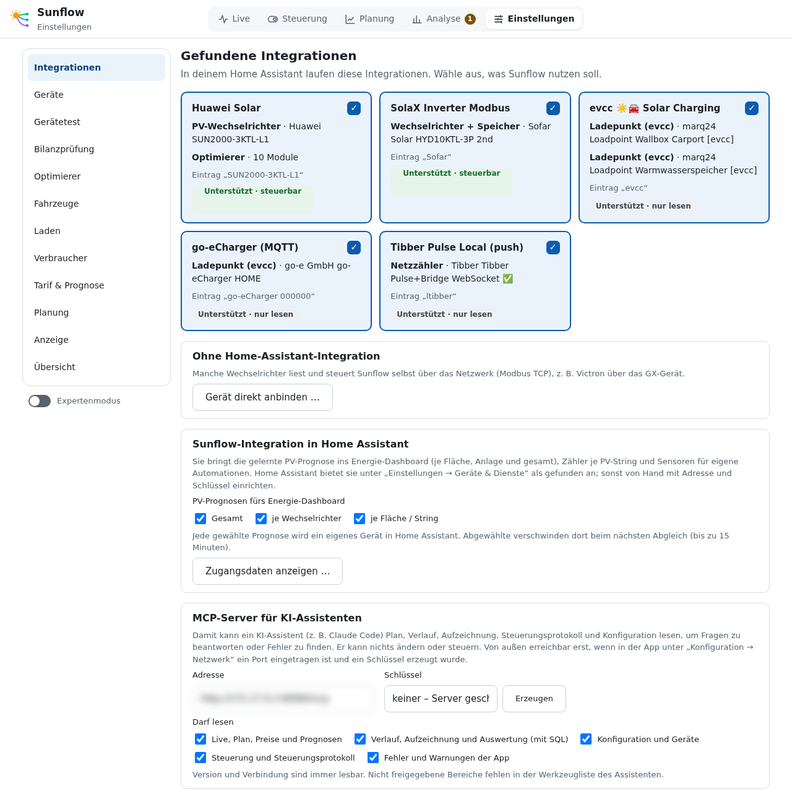
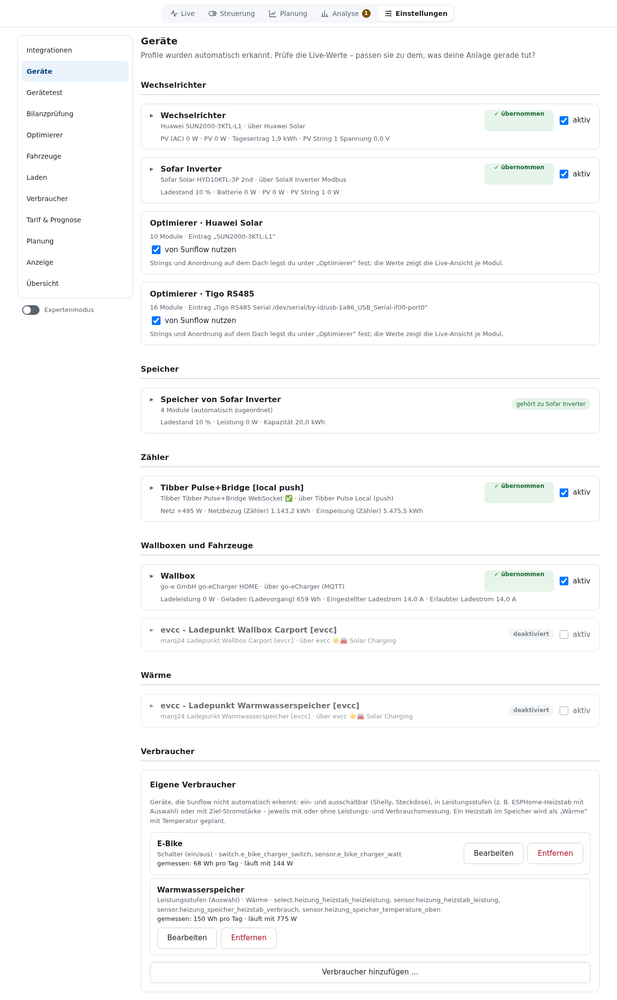
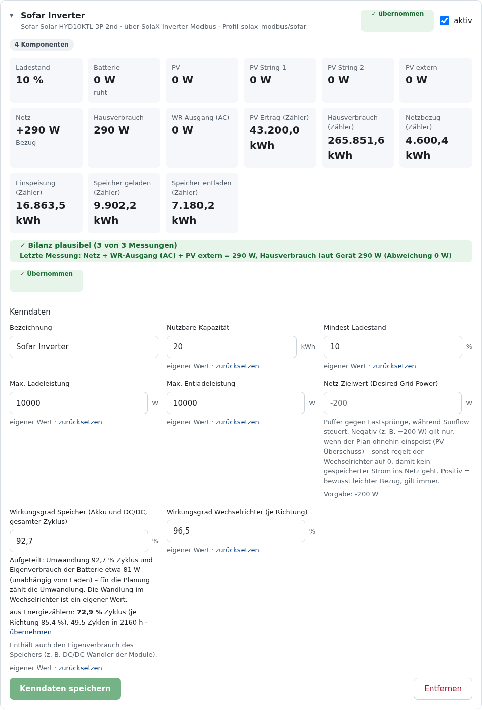
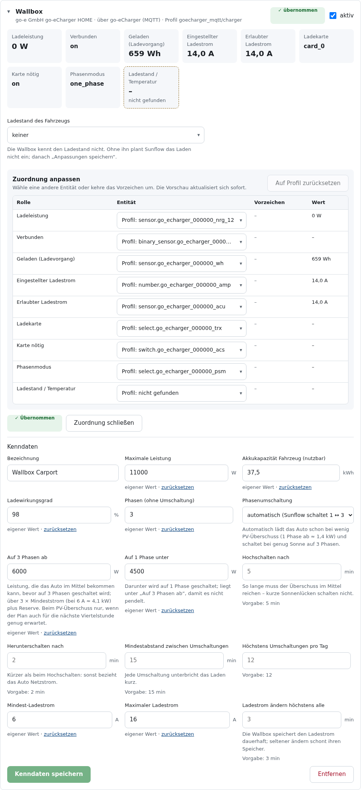
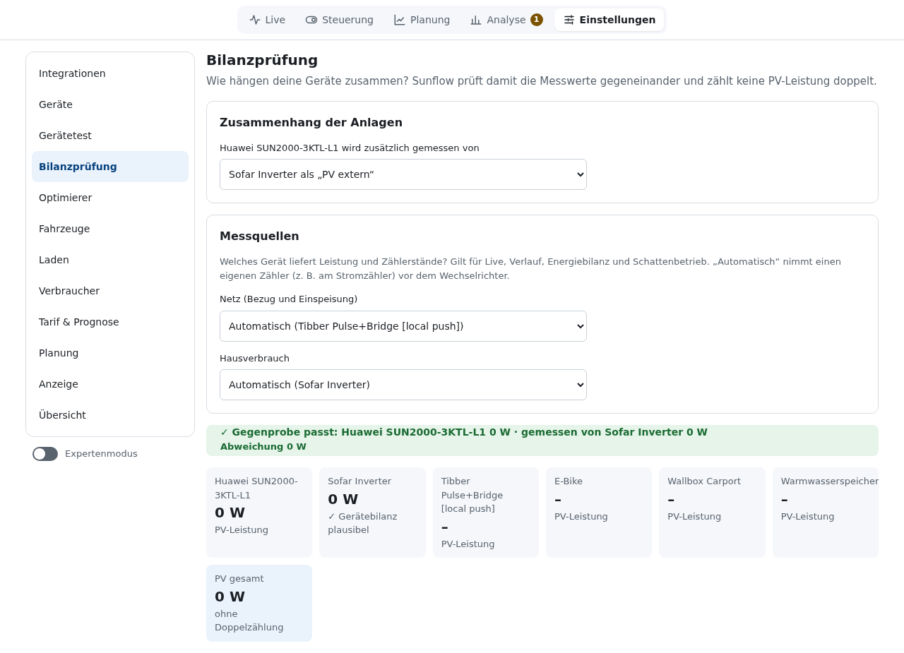
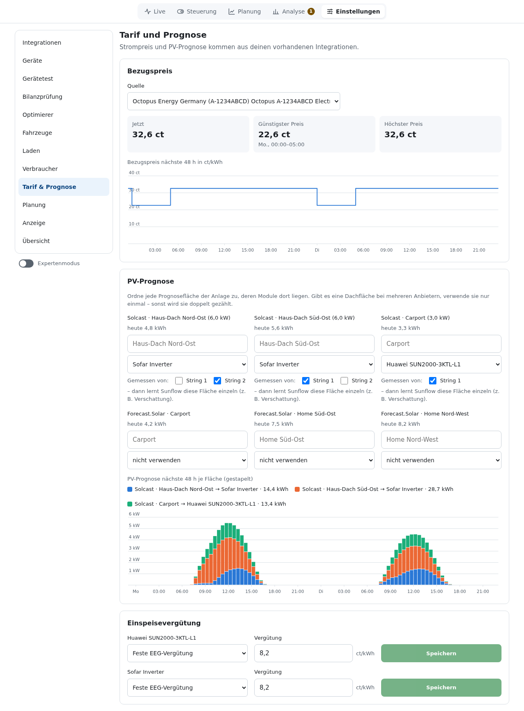
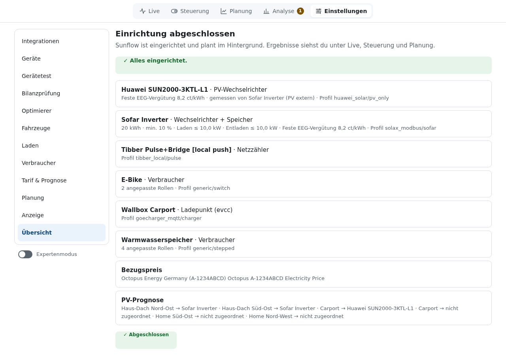

# Installation und Einrichtung

**Deutsch** · [English](en/installation.md)

## Voraussetzungen

- Home Assistant OS oder Supervised (für Apps, früher „Add-ons“).
- Die Integrationen deiner Geräte sind in Home Assistant eingerichtet, z. B. `solax_modbus` für
  den Wechselrichter, `goecharger_mqtt` für die Wallbox, Solcast oder Forecast.Solar für die
  PV-Prognose und eine Integration für den Strompreis. Welche Sunflow kennt, steht unter
  [Unterstützte Geräte](geraete.md) und [Strompreise](strompreise.md).
- Einige Geräte ohne Integration (z. B. Victron GX) bindet Sunflow direkt per Modbus TCP an.

## App installieren

1. In Home Assistant **Einstellungen → Apps → App-Store → ⋮ → Repositories** öffnen und
   `https://github.com/Zwer2k/sunflow` hinzufügen.
2. **Sunflow** installieren. Der Supervisor baut die App auf dem Gerät; das dauert einige Minuten.
3. Die App starten und „In Seitenleiste anzeigen“ einschalten. Sunflow öffnet sich im Panel.

Updates erscheinen wie bei jeder App, sobald eine neue Version veröffentlicht ist.

## Einrichtung Schritt für Schritt

Beim ersten Start führt Sunflow durch die Bereiche der Einstellungen. Mit **Weiter** geht es
zum nächsten; später erreichst du jeden Bereich direkt über die Seitenleiste.

Nur „kein Gerät“ blockiert die Einrichtung. Fehlen Strompreis, PV-Prognose oder
Einspeisevergütung, warnt Sunflow und rechnet mit Ersatzwerten (fester Preis, nur
Eigenverbrauch).

### 1. Integrationen

Sunflow listet die Integrationen in deinem Home Assistant, die es kennt, mit den gefundenen
Geräten. Hake an, was Sunflow nutzen soll. Das Etikett sagt, was möglich ist:

- **Unterstützt · steuerbar**: Sunflow kann messen und steuern.
- **Unterstützt · nur lesen**: Sunflow misst und plant. Steuern ist für diese Geräte nicht
  vorgesehen oder noch nicht geprüft.
- **Unterstützt · Optimierer**: liefert nur Modul-Optimierer.

Außerdem findest du hier:

- **Gerät direkt anbinden …** für Geräte ohne Home-Assistant-Integration (Modbus TCP).
- **Sunflow-Integration in Home Assistant**: welche PV-Prognosen ins Energie-Dashboard gehen,
  dazu Adresse und Schlüssel zum Einrichten von Hand. Siehe [Sunflow-Integration](integration.md).
- **MCP-Server für KI-Assistenten**: siehe [MCP-Server](mcp.md).

### 2. Geräte

Für jedes Gerät der gewählten Integrationen schlägt Sunflow ein Profil vor und zeigt die Live-Werte.
Prüfe, ob sie zu dem passen, was deine Anlage gerade tut, etwa ob Laden positiv und Entladen
negativ erscheint. Dann:

- **Übernehmen** nimmt das Gerät in Sunflow auf. Die Kategorie (Wechselrichter, Speicher,
  Zähler, Wallbox, Wärme, Verbraucher) wird dabei festgehalten.

Beispiel: Wechselrichter mit Speicher (Sofar)

- **Kenndaten** ergänzen, was Sunflow nicht messen kann: nutzbare Kapazität, Mindest-Ladestand,
  höchste Lade- und Entladeleistung, Wirkungsgrad, bei der Wallbox Phasen und Ströme, beim
  Warmwasser Volumen und Tagesbedarf. Felder mit „eigener Wert“ überschreiben den Vorschlag des
  Profils; „zurücksetzen“ nimmt wieder den Vorschlag.
- **Entitäten zuordnen** (Expertenmodus) ändert Entität, Einheit, Faktor oder Vorzeichen einer Rolle.

Beispiel: Wallbox (go-e) mit Zuordnung der Entitäten und Phasenumschaltung

- **aktiv** schaltet ein Gerät aus, ohne seine Einstellungen zu verlieren, z. B. um zwischen
  dem evcc-Ladepunkt und der go-e direkt zu wechseln.
- **Eigene Verbraucher**: Geräte, die Sunflow nicht selbst erkennt (Schalter, Leistungsstufen
  oder Ziel-Stromstärke), legst du unten auf der Seite an.
- **Optimierer**: Hat eine gewählte Integration Modul-Optimierer, steht unter „Wechselrichter“
  eine Karte mit „von Sunflow nutzen“. Siehe [Optimierer](optimierer.md).

### 3. Gerätetest

Für jedes steuerbare Gerät mit Speicher prüft ein kurzer Test, ob die Befehle ankommen und die
Vorzeichen stimmen:

1. 20 s den Ausgangszustand messen (nur lesen).
2. Falls nötig in den Steuermodus des Wechselrichters schalten (einmaliger Flash-Schreibzugriff).
3. 60 s Laden oder Entladen auf 300 W begrenzen oder mit 500 W aus dem Netz laden.
4. Prüfen, ob der Speicher in die erwartete Richtung folgt.
5. Zurück auf Eigenverbrauch und in den vorherigen Modus, 30 s beobachten.

Bei Abbruch oder Fehler setzt Sunflow sofort zurück. Pausiere vorher Automationen anderer
Systeme, die dieselben Werte schreiben. Erst mit bestandenem Test lässt sich die
[Steuerung](steuerung.md) für das Gerät einschalten. Reine PV-Wechselrichter brauchen keinen Test.

### 4. Bilanzprüfung

Hier legst du fest, wie die Geräte zusammenhängen. Ein Beispiel: Ein zweiter Wechselrichter wird
vom ersten als „PV extern“ mitgemessen, dann zählt Sunflow seine Leistung nicht doppelt. Unter
**Messquellen** wählst du, welches Gerät Netz und Hausverbrauch liefert. „Automatisch“ nimmt
einen eigenen Zähler am Stromzähler (z. B. Tibber Pulse) vor dem Wechselrichter.

Die Gegenprobe vergleicht die Messwerte miteinander und meldet, ob die Bilanz aufgeht.

### 5. Optimierer, Fahrzeuge, Laden, Verbraucher

Diese Bereiche brauchst du nur, wenn du die Geräte hast. Sie sind unter
[Einstellungen](einstellungen.md) beschrieben.

### 6. Tarif & Prognose

- **Bezugspreis:** der Sensor deines Tarifs. Sunflow liest den Preisverlauf, wo die
  Integration ihn anbietet. Bei reinen Börsenpreisen kommen Aufschlag und Mehrwertsteuer dazu.
  Siehe [Strompreise](strompreise.md).
- **PV-Prognose:** Ordne jede Prognosefläche (Solcast, Forecast.Solar) dem Wechselrichter zu,
  an dem ihre Module hängen. Gibt es eine Dachfläche bei mehreren Anbietern, nutze sie nur
  einmal, sonst zählt sie doppelt. Mit „Gemessen von“ lernt Sunflow eine Fläche einzeln
  (z. B. Verschattung am Vormittag).
- **Einspeisevergütung:** je Wechselrichter fest (EEG) oder dynamisch (Direktvermarktung).

### 7. Planung und Anzeige

Strategie des Hausspeichers, Ladegrenze, Notstrom-Reserve, Verschleißkosten und mehr: siehe
[Einstellungen → Planung](einstellungen.md#planung) und [So plant Sunflow](planung.md).

### 8. Übersicht

Die Übersicht fasst alle Geräte, den Tarif und die Prognose zusammen und zeigt, ob noch etwas
fehlt. Mit **Einrichtung abschließen** ist sie fertig. Sunflow plant ab jetzt im Hintergrund,
steuert aber noch nichts. Das schaltest du unter [Steuerung](steuerung.md) ein, wenn der Plan
für dich stimmig aussieht.

## Daten umziehen

Unter **Analyse → Schattenbetrieb** lädt „Daten exportieren“ eine ZIP-Datei mit Aufzeichnung,
Konfiguration, Steuerungsprotokoll und aktuellem Plan herunter. „Export importieren“ führt die
Aufzeichnung in eine andere Installation zusammen; die Konfiguration wird dabei nicht übernommen.
Schlüssel (Integration, MCP) sind nicht im Export.
