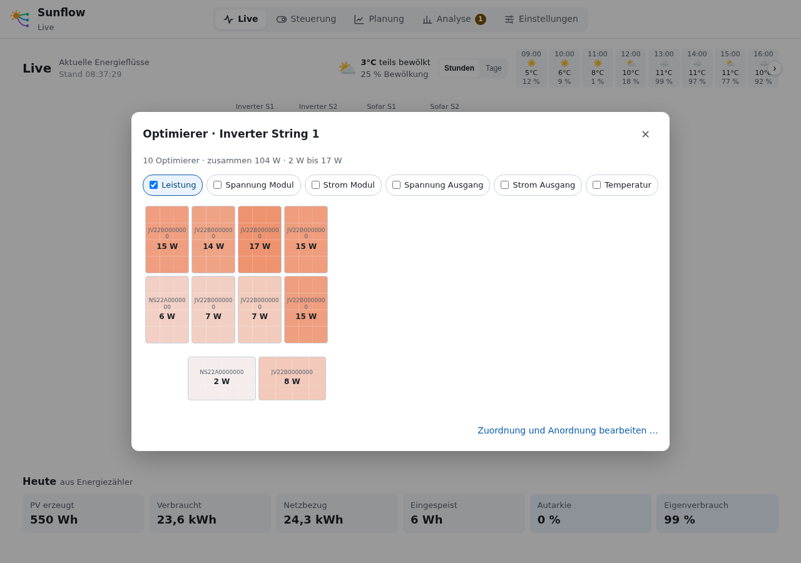
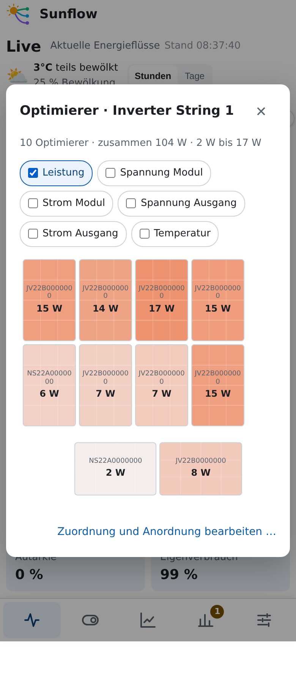

# Optimierer

**Deutsch** · [English](en/optimizers.md)

Sunflow zeigt Modul-Optimierer so, wie die Module auf dem Dach liegen: In der
Live-Ansicht öffnet ein Klick auf einen PV-String (Zahl am Kreis = Anzahl Optimierer)
seine Module mit den aktuellen Werten. Welche Werte erscheinen (Leistung, Spannung und
Strom am Modul bzw. Ausgang, Temperatur, PWM), lässt sich dort ein- und ausblenden; die
Wahl merkt sich der Browser. Hellere Module liefern weniger als das beste des Strings.

Oben stehen Anzahl, Summe und Spanne der Leistung. Die Module liegen so, wie sie unter
[Einstellungen → Optimierer](#einstellungen--optimierer) angeordnet sind; ein Abstand trennt
Dachstücke (hier zwei quer liegende Module unten). „Zuordnung und Anordnung bearbeiten …“ führt
dorthin.

## Quellen

| Hersteller | Integration | Werte | Zuordnung zum String |
|---|---|---|---|
| Huawei (SUN2000-…-P) | [Huawei Solar](https://github.com/wlcrs/huawei_solar) | Leistung, Spannung/Strom Ein- und Ausgang, Temperatur | Optimierer sind Unter-Geräte des Wechselrichters. Ist nur ein String in Betrieb, automatisch; sonst in den Einstellungen wählen (die Integration gibt den String nicht weiter). |
| Tigo TS4 | [Tigo RS485](https://github.com/Zwer2k/ha-tigo-rs485) | Leistung, Spannung Ein-/Ausgang, Strom, Temperatur, PWM | Über das Label aus der Tigo-Integration: „A1“ = String A (String 1 des Wechselrichters), Modul 1. Der Wechselrichter wird vorgeschlagen (der einzige ohne eigene Optimierer) oder gewählt. |

## Einbinden

Wie bei Wechselrichtern und Wallboxen entscheidest du, was Sunflow nutzt:

1. **Einstellungen → Integrationen:** die Integration auswählen. Ihre Karte zeigt, wie
   viele Optimierer sie hat; eine reine Optimierer-Integration wie Tigo RS485 erscheint als
   „Unterstützt · Optimierer“.
2. **Einstellungen → Geräte:** Unter „Wechselrichter“ steht je Integration eine Karte
   „Optimierer“ mit „von Sunflow nutzen“. Erst dann erscheinen die Module auf dem Dach und in
   der Live-Ansicht. Abgewählt verschwinden sie wieder; zugeordnete Plätze bleiben gespeichert.

Wer Optimierer schon vor Sunflow 0.72 auf dem Dach angeordnet hatte, behält deren
Integration als genutzt.

## Einstellungen → Optimierer

- **Quellen:** wie viele Optimierer je Integration genutzt werden; für Tigo der Wechselrichter, an dem sie hängen.
- **Dach je String:** Module auf freie Plätze ziehen oder antippen und dann den Platz
  antippen (Handy); auf ein anderes Modul gezogen tauschen beide. Ein ausgewähltes Modul
  lässt sich quer legen („quer legen“ / „hochkant stellen“). „Vorschlag
  wiederherstellen“ setzt String und Plätze auf den Vorschlag zurück.
- **Trenner:** „+ Trenner“ zwischen zwei Reihen bzw. das schmale „+“ zwischen zwei
  Plätzen (gilt für alle Reihen) setzt die folgenden Module ab, z. B. ein anderes Dachstück.
- **Zuordnung:** String und Name je Optimierer; „automatisch“ folgt dem Vorschlag.
